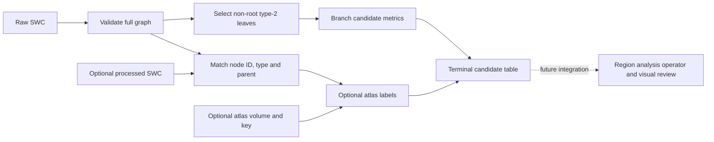
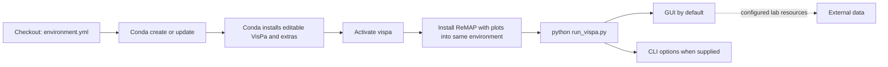
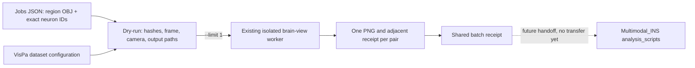
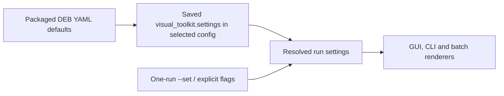

# VisPa — Visual Projectome Analysis tool

VisPa reviews macaque neuron and microscopy data configured by the DEB lab.
This checkout identifies as **1.21.5**. VisPa is a
Python package inside a Conda environment. Launch the GUI directly from this
checkout with `python run_vispa.py`.

[Install](#install-on-windows) · [Update an existing environment](#update-an-existing-vispa-environment) · [Remove VisPa](#remove-vispa)

## Batch review

Use **Bulk review…** beside Render for one-animal preparation, raw SWC caching, four-role rendering and receipt-verified resume. The dialog launches the packaged `vispa.review_bulk_prepare` and `vispa.review_bulk_render` modules, which also run with `python -m` from an installed wheel. Start with a dry run and one neuron; see the [batch guide](batch/MODULE.md) for source, output and review controls. Existing `batch.prepare_review_bulk` and `batch.render_review_bulk` imports remain compatibility entry points. The checkout-only `batch.remap_stepwise` bridge supplies ReMAP inputs and saved FNT scores to the same jobs contract. Figure completion and anatomical acceptance have separate review records.

## Code layout and responsibilities

One configuration manager, one data input adaptor, and a shallow rendering folder:

```text
run_vispa.py                         checkout GUI shortcut
src/vispa/
├── config.py                        defaults, validation, settings editing and safe saves
├── configs/config_deb.yaml           the single packaged profile
├── data_input_adaptor.py             dataset, SWC, IONData soma/side and ReMAP-table inputs
├── reviewer.py                       interactive review and preview orchestration
├── review_bulk_dialog.py             Bulk review dialog and background job control
├── review_bulk_prepare.py            whole-animal identities and managed raw cache
├── review_bulk_render.py             four-role rendering and verified resume
├── render_records.py                 shared animal process log and verified figure records
├── commands.py                       command routing; installed vispa command
├── input_resource_check.py           availability checks, not image/anatomy acceptance
├── fnt_tracer_launcher.py            native raw-SWC session preparation and tracer launch
├── swc_terminal_candidates.py        opt-in terminal-table API
├── renderers/
│   ├── microscopy_panels.py          Soma, Context, Sagittal and TrioPlot
│   ├── swc_brain_view.py             static and interactive mesh/SWC views
│   └── brain_volume_montage.py       separate volume montage operator
└── legacy_gl/                       preserved low-level graphics engine
```

Small former-name modules, including `neuron_side.py`, remain as compatibility
aliases to the same module objects; they contain no second implementation or
independent state. New code uses the names above. YAML/JSON stores values;
`config.py` owns configuration behavior. Packaged defaults live in `configs/`;
existing explicit user profiles, scientific data and cache locations are not
moved.

GUI and batch share these owners; checkout `batch/` compatibility wrappers do
not implement a second renderer. Saved-profile validation belongs to
`vispa.config.resolve_render_settings`, display-only region shortening to
`vispa.data_input_adaptor.display_region_name`, and flat output history to
`vispa.render_records`. Keep orchestration in the GUI or batch entry point and
call these public functions instead of copying their behavior into run scripts.
New outputs use `<output>/<sample>/neurons/001_R_M1/` with TrioPlot and Soma
volumes at that level, and individual Soma/Context/Sagittal PNGs in `plots/`.
One `<output>/<sample>/process_log.json` records all results; unknown side omits the `R/L` token.
Complete region identifiers and source-date status stay in that log.
`visual_toolkit.separate_plot_subfolder` controls the single-plot folder.
For samples 252383 and 252718, the saved `missing_context_samples` policy
permits a labelled empty Context box, retaining all three positions in TrioPlot.
It does not replace other acquisition failures with blank images.

```mermaid
flowchart TD
  A[run_vispa.py or installed vispa] --> C[commands.py]
  C --> G[reviewer.py]
  C --> K[config.py]
  G --> K
  Y[configs/config_deb.yaml or explicit user profile] --> K
  K --> D
  I[Dataset manifests, raw and processed SWCs, ReMAP workbooks] -->|data| D
  subgraph DI["data_input_adaptor.py"]
    D([dataset/SWC adaptor APIs])
    DSOMA([get_soma_coordinates()])
    DFETCH([_fetch_soma_catalog()])
    DSIDE([acquire_neuron_side()])
    DBATCH([acquire_neuron_sides()])
    DAPPLY([_acquire_side_from_soma()])
    SREG([side_from_region()])
    DCW([write_neuron_catalog_table()])
  end
  ION[/IONData getSoma JSON/] -->|data| DFETCH
  DFETCH -->|one exact soma| DSOMA
  DFETCH -->|all exact somas| DBATCH
  ATL[/NMT atlas, key and hemisphere mask/] -->|data| DAPPLY
  DSOMA -->|exact soma XYZ| DAPPLY
  DSIDE -->|calls| DAPPLY
  DBATCH -->|calls per requested ID| DAPPLY
  DAPPLY -->|calls| SREG
  G -->|calls for current neuron| DSIDE
  G -->|calls for visible catalog| DBATCH
  DSIDE -->|Side checking/Left/Right/unavailable| G
  DBATCH -->|Side rows and counts| G
  G -->|Save CSV table| DCW
  DCW -->|returns| CSV[/monkey_sample_neuron_table_timestamp.csv/]
  D --> P[renderers/microscopy_panels.py]
  K --> P
  G --> P
  P --> O[Soma, Context, Sagittal and TrioPlot]
  D --> B[renderers/swc_brain_view.py]
  K --> B
  U[One manifest-bound CHARM/SARM region OBJ] --> B
  B --> V[SWC Brain View and interactive window]
  D --> F[fnt_tracer_launcher.py]
  F --> N[Legacy swc_fnt_tracer: download, native conversion, catalog, launch]
  C --> M[renderers/brain_volume_montage.py]
  K --> M
  M --> Q[Montage and provenance receipt]
  D -. optional API .-> T[swc_terminal_candidates.py]
  R[Repository batch.remap_stepwise: explicit case] --> S[ReMAP population and saved FNT candidate]
  S -->|jobs| W
  subgraph BD["review_bulk_dialog.py"]
    BG([BulkReviewDialog])
  end
  subgraph BPREP["review_bulk_prepare.py"]
    BP([main])
  end
  subgraph BRENDER["review_bulk_render.py"]
    W([main])
  end
  G -->|opens| BG
  BG -->|launches worker| BP
  BG -->|launches worker| W
  BC[/Exact animal catalog or identity CSV/] -->|data| BP
  BP -->|frozen jobs| W
  K --> W
  W --> O
  subgraph RREC["render_records.py"]
    RR([record_neuron_output / verified_neuron_record])
  end
  G -->|calls| RR
  W -->|calls| RR
  RR -->|reads and writes| PL[/sample/process_log.json/]
  T -. planned .-> TR[Terminal image review]
  classDef callable fill:#E8F5EE,stroke:#23845B,color:#173B2C
  classDef data fill:#F1F5F9,stroke:#64748B,color:#1F2937
  class D,DSOMA,DFETCH,DSIDE,DBATCH,DAPPLY,SREG,DCW callable
  class I,ION,ATL,CSV data
  class RR callable
  class PL data
  style DI fill:#F4F8FF,stroke:#6186B5,color:#1F2937
  style RREC fill:#F4F8FF,stroke:#6186B5,color:#1F2937
```

Solid arrows show implemented components; terminal image-review integration is
planned. The adaptor reads declared ReMAP/legacy Step1 results, acquires exact
IONData soma coordinates, and derives side from the configured NMT atlas or
hemisphere mask. It does not run ReMAP analysis, choose the newest scientific
source by modification time, or register outputs automatically. Native raw
traces and atlas/processed traces remain separate inputs with declared frame,
units and provenance.

The GUI's **fnt-tracer** action calls the borrowed legacy `swc_fnt_tracer`
and `swc2fnt` functions in `fnt_tracer_launcher.py`. They retain the legacy
sequence: fetch the raw SWC, convert with `fnt-from-swc`, set its catalog,
then start `fnt-tracer`. Configuration supplies paths and URLs; bounded
requests and subprocess logs replace the legacy unbounded retries and waits.
Files retain their source names (`004.swc`, `004.swc.fnt`); an existing
NeuronView session keeps `251637-004-merge.fnt`. No coordinate transform or
guessed viewer state is added. The separate `fnt-prepare` command below remains
an explicit cached-input operator, rather than the GUI's launch path.

Inspect one neuron without downloads or writes:

```powershell
python run_vispa.py inputs --config src/vispa/configs/config_deb.yaml --sample 251637 --neuron 004.swc --dry-run
```

Add `--inspect` for file hashes, or `--workbook PATH` to select a particular
configured ReMAP table. Multiple matching workbooks require explicit selection.
Frame/unit values remain unknown when source evidence is absent.

Prepare a native FNT session from an explicitly declared raw SWC:

```powershell
python run_vispa.py fnt-prepare --config src/vispa/configs/config_deb.yaml --sample 251637 --neuron 004.swc --raw-path PATH_TO_RAW_SWC --dry-run
```

Remove `--dry-run` to run the bounded native converter into the configured cache.
The raw SWC and converter hashes, catalog and output receipt are checked before
reuse and launch. A manual analysis FNT is never substituted for the raw trace.
The GUI reports a process start separately from visible cube/image verification.
`fnt-fetch` remains an explicit legacy portal-download command.

For the current local candidate, use this review order (details and request
reconciliation are in `work/refactor_20261027/receipt.json`):

1. Restart with `python run_vispa.py` from this checkout; confirm **1.12.0.dev3**.
   Already open older windows retain their earlier code.
2. Open **SWC Brain View** for `251637 / 004.swc`; expect the full mesh and trace
   without the timestamp or worker-import error. The installed reference PNG is
   `work/refactor_20261027/outputs_dev24/251637_004_SWC_Brain_View.png`.
3. Run **fnt-tracer**; expect `004.swc.fnt`. The borrowed function's tested log
   reports both cube sources ready and 9/9 progress. Compare actual soma and
   trace placement with the legacy viewer; technical loading is not anatomical
   acceptance. No guessed transform or saved-view settings are inserted.
4. Review panel dimensions, markers and compact legends. Style preference and
   scientific acceptance remain separate user decisions.

Output settings resolve as fresh package defaults, active profile, then explicit
action overrides. Single panels and TrioPlot use configured dimensions/DPI and
the same marker/trace rules; all resolved review settings contribute to the GUI
cache identity. Legacy gain 2.0/threshold 100, scientific source selection and
coordinate mappings are retained. Synthetic style checks do not establish
anatomical acceptance. See `work/refactor_20261027/receipt.json` in the working
checkout for the current verification and review guide.

The default `config_deb.yaml` starts at **251637 / 004.swc** and uses the shared
server data and dependencies:

```text
\\10.102.8.200\microscopy_data\fMOST\resources\
├── config_deb.yaml
├── key_datasets\{CH00DS_datasets,5micron_datasets}
└── dependencies\
    ├── brain_view\
    └── fnt\
```

## Terminal candidate table (opt-in Python API)

`vispa.swc_terminal_candidates.terminal_table(raw_swc, processed_swc, atlas)` returns full-graph, non-root type-2 leaf candidates and raw-frame branch measurements. `processed_swc` and `atlas` are optional. When supplied, raw and processed nodes must have the same IDs, types and parent links; processed coordinates provide atlas labels at nominal 250 µm voxel scale. File inputs carry SHA-256 byte hashes in `input_provenance`; an in-memory tree has unknown source identity. The branch `sections_crossed` value uses a nominal 3 µm raw-sampling interval and is a candidate metric, not a validated physical section count. No GUI or command entry point calls this API yet.



Solid arrows show implemented table steps; the dashed arrow is planned integration. The API returns graph-end candidates only. Review of image support, trace continuation and anatomy is separate.

## Install on Windows

Open your existing **Miniforge Prompt** or **Anaconda Prompt**. If Conda is not installed, install [Miniforge](https://github.com/conda-forge/miniforge) first. Then run:

```powershell
git clone --branch main https://github.com/bylaikaby/VisPa.git D:\vispa
cd D:\vispa
conda env create -f environment.yml
conda activate vispa
python -m pip install "remap[plots] @ git+https://github.com/bylaikaby/ReMAP.git@main"
python run_vispa.py
```

If `vispa` already exists, [update it](#update-an-existing-vispa-environment), or create a separate new environment with `conda env create -n vispa-new -f environment.yml` and activate `vispa-new`. Recloning the repository does not remove an environment.
Activation selects the environment's Python; `run_vispa.py` starts the GUI. The ReMAP Git command requires repository access. If you already have a trusted local ReMAP checkout, use `python -m pip install "D:/ReMAP[plots]"` instead. Both packages then use the same `vispa` environment.

If the Windows `conda.exe` launcher itself fails, run the environment create or
update command as `python -m conda env ...` from the base Conda Prompt. If
activation also fails, launch with that environment's `python.exe` and the
absolute path to `run_vispa.py`. A restricted test session reported
`WinError 10013` for the neuron portal; the same endpoint returned HTTP 200
from a normal host process. Open VisPa from your normal Conda Prompt.

```powershell
& "$env:USERPROFILE\anaconda3\envs\vispa\python.exe" "D:\vispa\run_vispa.py"
```

Use `miniconda3` or `miniforge3` in that path if it is your installation folder.

For a downloaded ZIP, extract it locally and run the same commands in its folder. Conda reads the pip subsection of `environment.yml` and installs this checkout with its 3D and TIFF extras automatically. The file also selects conda-forge OpenBLAS; this avoids a reproduced Windows Matplotlib crash with the MKL-backed solve. Verify with `python -m pip check`, `python -m vispa --version` and `python -m remap --version`.

For a Python environment that already has the declared VisPa dependencies, install or upgrade only VisPa from a wheel with that environment's interpreter:

```powershell
& 'C:\path\to\env\python.exe' -m pip install --upgrade --no-deps 'C:\path\to\vispa-1.13.0.dev0-py3-none-any.whl'
& 'C:\path\to\env\python.exe' -m vispa --version
& 'C:\path\to\env\python.exe' -m pip check
```

`--no-deps` leaves other installed packages unchanged; use the Conda workflow above for a fresh environment that needs dependencies.

`python run_vispa.py check` verifies configured files and server/cache access. A disconnected lab share can make this check fail after a successful installation. TIFF support is included through the declared package extras.



## Update an existing VisPa environment

In Miniforge or Anaconda Prompt, inspect the checkout first:

```powershell
cd D:\vispa
git status --short --branch
git branch --show-current
```

A ZIP download has no Git history and cannot use `git pull`. For Git updates, clone into a new folder and keep the old folder and its data until reviewed.

Continue only on `main` with a clean working tree. If it is dirty or has diverged, inspect and resolve it yourself; do not reset or autostash it. Then:

```powershell
git pull --ff-only origin main
conda env update -n vispa -f environment.yml
conda activate vispa
python -m pip install --force-reinstall --no-deps "remap[plots] @ git+https://github.com/bylaikaby/ReMAP.git@main"
python run_vispa.py
```

Use the checkout's actual path if it is not `D:\vispa`.

### Adopt new lab defaults

To adopt new lab defaults, use **Settings → Factory default YAML → Restore factory → Save settings**, or launch with the shared profile directly:

```powershell
python run_vispa.py gui --config '\\10.102.8.200\microscopy_data\fMOST\resources\config_deb.yaml'
```

`python run_vispa.py check` must report **All configured resources ready** before rendering. Each line includes its resolved file, folder, or server location.

## Remove VisPa

To remove an old VisPa package while keeping ReMAP and data in its existing environment:

```powershell
& '.\scripts\uninstall_vispa.ps1' -Python 'C:\path\to\env\python.exe' -DryRun
& '.\scripts\uninstall_vispa.ps1' -Python 'C:\path\to\env\python.exe'
```

The script prints the exact interpreter, checks pip, removes only `vispa`, verifies its absence, and checks that an already installed ReMAP remains. It does not remove the environment, dependencies, configuration, caches, outputs or source checkouts. Run it from this repository root or use the script's absolute path.

After the new shared environment is verified, you may remove an old environment named `vispa` only if it is distinct from the new environment and no longer needed:

```powershell
conda deactivate
conda env remove -n vispa
```

This optional command removes all packages in that environment, including ReMAP. Repositories, user configuration, caches and scientific data stored outside it remain in place. Check the environment name before removal.

## Create or select a configuration

The existing shared 1.0.6 profile is
`\\10.102.8.200\microscopy_data\fMOST\VisPa\configs\ded_vispa_config_v1.0.6.yaml`.
It declares the shared sample, DS00,
5 µm, raw SWC, processed SWC, mesh, catalog, and IONData resources as read-only
inputs. Cubes, SWCs and FNT work use
`\\10.102.8.200\microscopy_data\fMOST\VisPa\cached_data`. That profile writes
figures under `\\10.102.8.200\microscopy_data\fMOST\VisPa\outputs`. The
packaged DEB 1.0.8 profile routes GUI Render figures to
`\\10.102.8.200\microscopy_data\fMOST\Vispa_outputs/<sample>/neurons/<neuron>/`.
An existing profile can set `visual_toolkit.figure_output_root` to choose the
same root without changing its general output directory.

The YAML contains only `config_name`, `config_version`, and
`config_updated_at` (an ISO-8601 timestamp with offset). Configuration history
is maintained in [CHANGELOG.md](CHANGELOG.md#configuration-history). This is
configuration provenance, not proof that a scientific run was accepted.
Package upgrades do not overwrite the local YAML.

Confirm the package/config pair without launching the GUI:

```powershell
python -m vispa --version --config \\10.102.8.200\microscopy_data\fMOST\VisPa\configs\ded_vispa_config_v1.0.6.yaml
python -m vispa config-check --validate-only --config \\10.102.8.200\microscopy_data\fMOST\VisPa\configs\ded_vispa_config_v1.0.6.yaml
python -m vispa config-check --compare-defaults --config \\10.102.8.200\microscopy_data\fMOST\VisPa\configs\ded_vispa_config_v1.0.6.yaml
```

Use `vispa --test` (or `vispa gui --test`) for a local test launch. It loads the
same `ded_vispa_config` identity and read-only resources, then redirects caches
to `fMOST\VisPa\cached_data\test` and outputs to `fMOST\VisPa\outputs\test`
for that process only. The YAML is not
rewritten. `config-check --test` exposes the same resolved test paths.

The GUI title, Version action, and resource-check header show the same current
identities and config update time. The resource-check window also shows key
resolved paths above its compact scrollable checklist. To select this profile
for one PowerShell session, set
`$env:VISPA_CONFIG='\\10.102.8.200\microscopy_data\fMOST\VisPa\configs\ded_vispa_config_v1.0.6.yaml'`. Validate configured
source paths separately; this syntax check does not establish anatomical or
scientific acceptance.

Create the per-user profile without overwriting an existing file:

```powershell
python run_vispa.py config-init --dry-run
python run_vispa.py config-init
```

Pass `--config PATH` to any command to select another profile. Relative paths
resolve from that YAML/JSON file. Binary assets, microscopy data and credentials
remain external.

## Parse update notes without GitHub sign-in

`vispa updates` reads the repository CHANGELOG by default. It can also parse a
local Markdown/JSON file, a plain HTTP(S) static feed, or the existing clone's
local Git history. These paths do not call GitHub APIs or attach credentials.

```powershell
python run_vispa.py updates --limit 3
python run_vispa.py updates --source git --repo D:\vispa --limit 5
python run_vispa.py updates --source \\10.102.8.200\microscopy_data\fMOST\VisPa\updates.json --json
python run_vispa.py updates --source https://example.org/vispa/updates.json
$env:VISPA_UPDATES_SOURCE='git'
```

Git mode is deliberately offline. It runs local `git log`/`rev-parse` against
already available objects and sets `GIT_TERMINAL_PROMPT=0` and
`GCM_INTERACTIVE=Never`; it never runs fetch, pull, `ls-remote`, or a GitHub API
request. A missing Git executable or checkout is reported instead of prompting.

The JSON feed shape is:

```json
{
  "schema": "vispa.updates.v1",
  "releases": [
    {
      "version": "1.20.0",
      "date": "2026-11-04",
      "status": "local/unreleased",
      "changes": ["Credential-free update parsing."]
    }
  ]
}
```

`latest_version` is the first parsed record, not a claim that it is newer than
the installed package. `matches_installed` reports exact string equality. Inputs
are limited to 1 MiB; HTTP(S) and local Git reads default to a five-second
timeout. If an intranet host requires authentication, publish an anonymously
readable feed or synchronize the file separately and pass its local path.

### IDE setup

Find the exact interpreter:

```powershell
python -c "import sys; print(sys.executable)"
```

Select that interpreter in the IDE and use the cloned checkout as the working
directory.

## Commands explained

| Task | Simple command | What it does |
|---|---|---|
| Open the GUI | `python run_vispa.py` | Opens the normal review interface. |
| Check readiness | `python run_vispa.py check` | Prints a path-aware checklist for the configured sample and neuron. |
| Show version | `python run_vispa.py --version` | Prints the installed VisPa version. |
| Parse updates | `python run_vispa.py updates --limit 3` | Parses CHANGELOG, JSON, plain HTTP, or existing local Git history without GitHub sign-in. |
| Validate a config | `python run_vispa.py config-check --validate-only --config PATH` | Checks YAML/JSON structure without reading lab data. |
| Audit one resource set | `python run_vispa.py config-check --sample SAMPLE --neuron 004.swc` | Reports exact paths, hashes, geometry and cache references. |
| Open SWC Brain View interactive | `python run_vispa.py brain-view --sample 251637 --neuron 004.swc` | Opens the configured mesh and processed SWC. |
| Render a montage | `python run_vispa.py montage --input FILE --output FILE --units mm` | Creates a five-view DS00 montage. |
| Fetch FNT | `python run_vispa.py fnt-fetch --sample 251637 --neuron 004.swc` | Retrieves one exact FNT into the user cache. |
| Create user config | `python run_vispa.py config-init` | Creates the per-user profile without overwriting an existing file. |
| Run tests | `python -m unittest discover -s tests -v` | Runs all automated tests. |

`python run_vispa.py` is the single GUI and command entry point in this checkout.

The [Windows Conda workflow](.github/workflows/windows-python-conda.yml) creates
the declared environment, installs editable VisPa, checks shared analysis-library imports and the script entry point, and runs source and batch tests. ReMAP itself is installed separately by the command above and is tested locally when repository access is available.

## GUI walkthrough

```powershell
python run_vispa.py
```

1. Wait for **VisPa data check**. A ready profile shows a check mark and the
   resolved location for every required resource.
2. Confirm the Sample ID and Neuron ID, or open **Neuron list** and select one.
   The catalog briefly shows **Checking** while VisPa loads all sides through
   the same IONData-soma/NMT-atlas mechanism used by the current-neuron Side
   status, then colors rows by Left, Right, or Unknown.
3. A valid Sample ID and Neuron ID trigger the Soma lookup automatically.
   After loading, VisPa automatically reports and opens matching cached
   rendering data. The Neuron status uses a compact `cached` suffix when cached
   figures exist; missing or stale-cache details remain in the status bar.
   **Target soma coordinates** shows editable physical X/Y/Z in µm and a
   read-only NMT template voxel row from the existing VisPa IONData-soma/atlas
   side lookup. Editing physical coordinates does not relabel that atlas voxel.
4. **Update figures** beneath Neuron list refreshes IONData and rerenders the
   selected figures from the existing acquisition cache. **Re-process** refreshes
   the SWC and acquires source
   cubes/slices again before rebuilding all panels. **Render** remains available
   for an ordinary render.
5. Review **Soma**, **Context**, **Sagittal**, **TrioPlot** and **SWC Brain View**. The
   **SWC Brain View** tab shows a static snapshot of the current processed neuron on the template mesh.
   A grey panel tab means Render did not produce its image; check **Process log**
   for the panel error. **TrioPlot** requires all three other panels. A ready
   data check confirms configured resources, not a successful render.
   Panel titles keep one Region section. The portal-derived NMT value is shown
   as `nmt_portal`; an optional corrected value appears only when supplied, for
   example `Region: nmt_portal=Left background · nmt_corrected=Right PrCO`.
6. Use **SWC Brain View interactive** for the separate rotatable OpenGL viewer; use **fnt-tracer** for the
   matching annotation project.
7. Use **Check data** at any time to repeat the readiness checklist.

Clear **Save outputs** for preview only. Otherwise, the folder under **Saving**
receives the rendered panels.

The optional morphology-only example is CLI-only and separate from lab data:

```powershell
python run_vispa.py example --dry-run
```

## Advanced operational details

This repository is the standalone development workspace. Package/distribution:
`vispa`. Activate the Conda environment and run `python run_vispa.py` from
the checkout. Use `python run_vispa.py gui --help` for GUI options.

`VISPA_CONFIG` and `VISPA_WHEELHOUSE` are the VisPa environment handles. Pass
`--config PATH` for a specific run; otherwise `VISPA_CONFIG` wins, then the own
per-user config at `%APPDATA%\VisPa\vispa_config.yaml`. Caches and outputs default
to `%LOCALAPPDATA%\VisPa`. Existing `visual_toolkit` settings blocks and
`visual-toolkit.*.v1` receipt schemas remain readable protocol data, but they do
not provide compatibility Python modules or commands.

The Python API is imported only as `vispa`. The legacy `Visual_toolkit`
forwarding package and class alias have been removed. Optional OpenGL remains
lazy. Use `python run_vispa.py` for the GUI and `python run_vispa.py --help` for commands.

New standalone run receipts, builds and candidate outputs live under `D:/VisPa/work/`. The [shared validation receipt](work/fnt_onboarding_20261022/run_receipt.json) records versioned milestones separately; [the Windows Conda workflow](.github/workflows/windows-python-conda.yml) validates the Python-only environment. The living project journal remains `D:/projectome_analysis/docs/project_note.md`. Existing projectome receipts remain historical evidence; external scientific data/cache paths remain explicit configuration.

### Repository status and compatibility

VisPa includes a live per-sample IONData neuron list for the configured lab intranet and review panels for configured local microscopy resources. The live list is fetched from the neuron API; image cubes, raw SWCs, and microscopy files use separate configured hosts or shares. The package contains only server addresses and candidate sample-resource links, not source data, credentials, or local project tools. These links and checksums do not establish current share availability or scientific acceptance.

This checkout is **1.12.0.dev3, without a release tag**. It preserves the
existing rendering and source-verification algorithms while removing the
retired `Visual_toolkit` compatibility namespace. The DS00 sagittal panel now
shows one provisional soma-location marker without A/B raw-SWC traces; its
manifest, hash, geometry, and source checks remain. Marker placement still
requires independent anatomical validation. No study data, credentials, or
private source files are included; the package profile declares server
endpoints and ten known sample mappings without copying images or SWCs.
`extraction_manifest.json` records the historical extraction snapshot and is
excluded from source distributions. The historical dev6 receipt does not
verify the current candidate.


The supported Windows route is Conda plus `python -m`. VisPa and ReMAP share
the `vispa` environment; an existing broader Projectome environment can remain
unchanged. Run the source test command
`python -m unittest discover -s tests -v` inside that environment. Older
pip/venv/executable artifacts are historical and are not required.

The headless operator is `vispa render`. It accepts one local `.npy` array in ZYX or YX order, a declared soma coordinate, origin, voxel spacing, role, and output directory. The three coordinate triples use XYZ micrometres. TIFF, NIfTI, SSH, and YAML extras remain available to backend and GUI workflows. The first run should use `--dry-run`, which resolves the inputs, settings, output PNG and receipt without creating directories, reading image pixels, or accessing a source. A real run writes the PNG and its JSON receipt and refuses to overwrite either.

```text
vispa render --input cube.npy --sample sample-01 --neuron 0007 --soma 120 240 30 --origin 0 0 0 --resolution 0.65 0.65 3 --coordinate-frame sample-native-XYZ --role soma --output-dir review --dry-run
```

Use `--role context` for the 5 µm style. `--set PATH=VALUE` overrides review settings; scalar values and numeric sequences are supported, such as `--set figure.panel_dpi=400` or `--set soma_window.cubes_xy_steps=1.5,1.25,1`. Unknown keys, out-of-range values and invalid combinations fail before changing global settings. Run `vispa settings` to print each setting's default, current value, valid range and effect as JSON. Python callers can use `review_settings_schema()` and pass a mapping or a list of `PATH=VALUE` strings to `apply_setting_overrides()`. The single-panel review figure includes the image and target marker legend and labels the displayed plane as native X/Y. The cyan cross marks the supplied coordinate; an optional centre box can be enabled with `marker.box_mode=on`. Neither validates anatomy, orientation, or laterality. The labeled single-panel CLI review reserves font-measured clearance between its axes and shared legend; multi-panel and unlabeled figures retain the legacy layout.

`python run_vispa.py gui` starts the optional Tk interface. `python run_vispa.py --help` and `python run_vispa.py --version` do not load image libraries, open windows, or acquire data. Package import does not change `sys.path` or import `IONData`.

The compatibility command `python run_vispa.py example` fetches one public SWC for a morphology-only preview. It does not exercise the lab image, atlas, FNT, or brain-view paths. The cached source is checksum-pinned; its coordinate frame and units are unspecified. Preview its source URL and proposed output locations without network or file access first:

```powershell
python run_vispa.py example --dry-run
```

The one-record operation accepts `--cache-dir`, `--output-dir`, and `--dpi` (100–240; default 160). It reuses an existing figure only when its receipt, source checksum, VisPa version, renderer-code checksum, DPI, full-extent declaration, and PNG hash match; changed renderer code, version, or DPI uses a named variant, and conflicting files are preserved. No sample configuration is required.

## One-volume DS00 montage

`python run_vispa.py montage` renders one explicitly named 3D NIfTI into the preserved five DS00 views. It does not discover cohorts, read workbooks, choose files, or apply a transform. The affine must yield LPS voxel axis codes, as in the source montage. NIfTI affines map voxel indices into RAS+ world coordinates; each panel labels increasing projected anatomical directions in RAS+ millimetres. The header must declare millimetres, or the operator must explicitly declare `--units mm` when the header units are unknown; known non-mm units are rejected. The output includes a compact intensity-image legend. The `[3d]` extra provides the montage dependencies.

Each view covers the complete input NIfTI voxel-cell extent: all eight outer corners, including half-voxel margins, are projected through the input affine. Foreground intensity locates the projection origin but does not crop the field of view. The adjacent v2 receipt names each extent `projected_extent_centroid_relative_mm` and records its `projection_origin_ras_world_mm`; these offsets are not absolute world coordinates. The input determines the reference extent, so provide a full reference image when full reference coverage is required.

```powershell
python run_vispa.py montage --input 'D:\data\sample.nii.gz' --output 'D:\review\sample-5view.png' --units mm --max-voxels 64000000 --set display_gamma=0.88 --dry-run
```

Review the resolved header, affine, setting values, output path, and receipt path. Remove `--dry-run` to write a new PNG and adjacent JSON receipt. The command requires the explicit `--units mm` declaration, refuses existing outputs and input overwrite; it hashes the source before and after rendering and removes partial outputs if rendering fails. The default bound is 64 million voxels; `--max-voxels` can change that bound explicitly. `--set KEY=JSON_VALUE` is repeatable and only accepts the settings below. The Python mapping `vispa.renderers.brain_volume_montage.SETTING_SPECS` also provides each parameter's default, effect, unit, and validated range.

| Setting | Default | Unit / valid range | Effect |
|---|---:|---|---|
| `figure_size_inches` | `[18.2,4.4]` | inches / 1–100 each | Single-volume figure width and height |
| `figure_dpi` | 120 | DPI / 36–600 | Single-volume PNG output resolution |
| `max_dimension` | 210 | voxels / 1–4096 | Maximum downsampled array dimension |
| `otsu_sample_stride` | 8 | samples / 1–4096 | Otsu histogram input stride |
| `otsu_clip_percentile` | 99.5 | % / 0–100 | Otsu upper clipping percentile |
| `intensity_high_percentile` | 99.3 | % / 0–100 | Upper display intensity percentile |
| `minimum_intensity_span` | 1.0 | input intensity / >0 | Minimum separation of low/high values |
| `blur_sigma_voxels` | `[0.45,0.45,0.95]` | voxels / 0–1000 each | Downsampled-volume Gaussian blur |
| `foreground_threshold` | 0.08 | normalized / 0–1 | Threshold for foreground samples locating projection origin |
| `min_foreground_voxels` | 1000 | voxels / ≥1 | Minimum foreground count |
| `max_foreground_points` | 300000 | points / ≥1 | Maximum samples locating projection origin |
| `view_extent_percentiles` | `[0.6,99.4]` | % / 0≤low<high≤100 | Legacy direct `composite_view` bounds only; no montage FOV effect |
| `depth_percentiles` | `[0.3,99.7]` | % / 0≤low<high≤100 | Legacy direct `composite_view` depth only; no montage FOV effect |
| `projection_padding_fraction` | 0.07 | fraction / 0–1 | Legacy direct `composite_view` padding only; no montage FOV effect |
| `minimum_extent_mm` | 5.0 | mm / >0 | Minimum accepted view extent |
| `projection_bin_mm` | 0.36 | mm/pixel / >0 | Projected sampling interval |
| `horizontal_bins_px` | `[150,260]` | pixels / 1–4096 each | Output width bounds |
| `vertical_bins_px` | `[150,280]` | pixels / 1–4096 each | Output height bounds |
| `depth_step_mm` | 0.55 | mm/step / >0 | Nominal ray sampling interval |
| `depth_bins` | `[56,110]` | samples / 1–1024 each | Ray sample-count bounds |
| `ray_extinction` | 8.0 | unitless / >0 | Opacity growth along each ray |
| `layer_alpha_cap` | 0.88 | fraction / 0–1 | Maximum opacity per ray layer |
| `normalization_percentile` | 99.5 | % / 0–100 | Composite intensity normalization |
| `display_gamma` | 0.88 | unitless / >0 | Composite display gamma |
| `background_cutoff` | 0.012 | normalized / 0–1 | Dark-background suppression |
| `min_positive_pixels` | 200 | pixels / ≥1 | Minimum nonzero composite count |
| `min_filled_fraction` | 0.04 | fraction / 0–1 | Minimum filled-view fraction |
| `green_channel_scale` | 0.985 | fraction / 0–1 | Green-channel display tint |
| `blue_channel_scale` | 0.94 | fraction / 0–1 | Blue-channel display tint |

These are display settings inherited from the project montage. The three legacy extent settings remain accepted for configuration compatibility, but the full-volume montage ignores them. They do not change anatomy or establish registration or scientific acceptance.

`environment.yml` installs the optional 3D dependencies in the Conda runtime. The legacy OpenGL viewer requires a local OBJ mesh, an explicit sample ID and processed
SWC filename, and explicit coordinate-frame and coordinate-unit declarations in
`sources.brain_view`; it does not resolve cohort identities, use raw SWCs, fetch remote
data, or apply registration/mirroring. Preview the resolved paths and display settings
before launching a window:

```powershell
python run_vispa.py brain-view --sample 251637 --neuron 004.swc --config 'C:\data\vispa_config.yaml' --dry-run
```

The GUI passes the current portal soma-region field to the 3D worker. A numeric
portal key such as `PrCO_49` may select a verified bilateral `PrCO` OBJ only
through the optional hierarchy map described below; numeric keys never use
acronym-only fallback. The legend identifies **Bilateral soma region · PrCO**.
Missing or ambiguous mappings remain root-plus-SWC and are
reported as **Soma region unavailable**. There is no GUI region picker. CLI
review may explicitly request one exact filename, display name or acronym:

```powershell
python run_vispa.py brain-view --sample 251637 --neuron 004.swc --region PrCO --dry-run
```

The selected OBJ must match `region_mesh_manifest.json` by filename, byte count
and SHA-256. Only one region is loaded; the camera continues to use the complete
NMT root mesh bounds.

The orange trace role is **Processed neuron SWC**. High-value controls are
public rather than hidden in renderer constants: use named CLI flags for quick
tuning, `--set KEY=VALUE` for the complete validated settings surface,
`vispa settings --scope brain-view` for discovery, and `camera_overrides` plus
`region` in bounded batch jobs. Dry-run plans and receipts show resolved values.

Remove `--dry-run` for an interactive review, or add `--snapshot 'D:\review\view.png'`
for one bounded PNG plus adjacent JSON receipt. Existing outputs are never overwritten.
The receipt records source hashes, frame/units as declared, camera/clipping settings,
worker/runtime and renderer hash. The initial pose uses a numeric oblique display vector;
it does not assert anatomical orientation. The renderer centers the stored mesh and SWC
together without changing their coordinates. The processed SWC's single declared
`parent=-1` root is shown as the distinct cyan **Soma** sphere; its stored coordinate,
color and radius are recorded without inferring anatomy or applying a transform. To tune the display, set `sources.brain_view.settings`
keys `eye_direction`, `up`, `camera_distance_scale`, `line_width`, `soma_radius`,
`background`, `mesh_color`, `neuron_color`, `soma_color`, and `window_size`, or pass the matching
`--eye-direction`, `--up`, `--camera-distance-scale`, `--line-width`, `--soma-radius`,
`--background`, `--mesh-color`, `--neuron-color`, `--soma-color`, and `--window-size` flags. The core
package remains installable without the `[3d]` OpenGL dependencies.

| Setting / CLI flag | Default | Effect | Valid range |
|---|---:|---|---|
| `eye_direction` / `--eye-direction X Y Z` | `[-1.3, 1.6, 1.5]` | Initial viewing direction in centered display coordinates | Three finite values; nonzero and not parallel to `up` |
| `up` / `--up X Y Z` | `[0, 0, 1]` | Initial camera up direction | Three finite values; nonzero and not parallel to `eye_direction` |
| `camera_distance_scale` / `--camera-distance-scale` | `0.40` | Scales the bounds-fit distance (`scale × √3 × mesh diagonal`) | Positive finite number |
| `line_width` / `--line-width` | `2.0` | Processed-neuron line width | Positive finite number |
| `soma_radius` / `--soma-radius` | `500.0` | Display-only processed-SWC root marker radius; not biological soma size | Positive finite number |
| `background` / `--background R G B` | `[0, 0, 0]` | Window background color | Each RGB component in `[0, 1]` |
| `mesh_color` / `--mesh-color R G B` | `[0.8, 0.8, 0.8]` | Brain-mesh display color | Each RGB component in `[0, 1]` |
| `neuron_color` / `--neuron-color R G B` | `[1, 0.5, 0]` | Processed-neuron display color | Each RGB component in `[0, 1]` |
| `soma_color` / `--soma-color R G B` | `[0, 1, 1]` | Distinct processed-SWC root/soma marker color | Each RGB component in `[0, 1]` |
| `window_size` / `--window-size WIDTH HEIGHT` | `[1100, 800]` | Initial viewer dimensions in pixels | Two integers, each at least 100 |

An optional `sources.brain_view.region_hierarchy_map` can bind a cortical portal
key such as `PrCO_49` to a verified pair of CHARM level-6 labels and one hashed
OBJ from `sources.brain_view.region_manifest`. Generate the local map with
`python batch/build_region_hierarchy_map.py --charm CHARM_key_table.csv --sarm
SARM_key_table.csv --mesh-manifest region_mesh_manifest.json --aliases
batch/reviewed_nmt_region_aliases.json --output region_map.json`. The builder
requires an exact hierarchy full-name match or one explicit nomenclature alias
bound to family, level-6 index, acronym, full name, OBJ filename and manifest
hash. Missing meshes, unreviewed aliases, ambiguous names and a changed
manifest remain unavailable. The included aliases address nine exact spelling
or punctuation differences; SARM CAP remains withheld because its acronym
collides with an unrelated mesh. These names do not establish geometry.
The map is opt-in and does not infer anatomical alignment, neuron laterality or any
coordinate transform. Cortical portal suffixes are side-collapsed canonical
keys: `PrCO_49` occurs for a workbook-recorded right `CR_PrCO` neuron, while
CHARM atlas indices are `CL_PrCO=49` and `CR_PrCO=549`. The worker verifies
that both CHARM sides select the same OBJ, records the canonical region key,
and does not report a neuron side. Subcortical portal suffixes have an
unverified namespace (`Cl_304` differs from SARM `SL_Cl=1004`); they remain
unmapped until a source-backed namespace bridge is supplied. Portal numbers
must never be treated as D99 labels or side-specific NMT indices.
Without the map, numeric portal region labels leave the region mesh unavailable
with a receipt reason; they are not reduced to acronym-only guesses. An
operator can still request an exact filename/acronym with `--region`, which is
reported as an explicit selection rather than a verified atlas-index mapping.

## Explicit brain-view batches (local dev13 candidate)

Use [the batch guide](batch/README.md) and the placeholder [example jobs](batch/local_pilot.example.json) for selected mesh/neuron pairs. Keep machine-specific filled jobs outside version control. One job renders one existing OBJ mesh with one named processed SWC through the same VisPa OpenGL worker. This does not combine multiple neurons in one scene. A supplied region mesh must already be in the declared processed-SWC frame and units; VisPa applies no registration, scaling or mirror transform.



```powershell
cd D:\VisPa_publish_20261023
python -m batch.render_brain_views --jobs work/jobs/filled-local-jobs.json --output-root work/results/brain-view-batch-new-run --limit 1 --dry-run
python -m batch.render_brain_views --jobs work/jobs/filled-local-jobs.json --output-root work/results/brain-view-batch-new-run --limit 1
```

`--limit N` selects N sorted jobs. Full execution requires both `allow_all: true` in jobs JSON and `--all`; outputs require a fresh root. Job groups expose `sample_id`, stable output-group `region_id`, existing `mesh_path` (OBJ), `mesh_label` (1–18 printable characters), exact `neuron_ids`, matching `coordinate_frame` and `coordinate_units`, optional exact `region`, optional `portal_region`, and `camera_overrides` using the brain-view setting names and valid ranges above. The single-view CLI also accepts `--mesh-path`, `--mesh-label` and `--region`; when absent, the configured whole-brain mesh and its legend remain the defaults. In overlay mode, the selected region is hash-bound and the full root mesh still defines camera extent. The prior pilot and current bounded region snapshot establish technical rendering and legend readability only; anatomical acceptance remains unverified.

## Shared settings interface

Saved tuning uses one configuration file and one clear precedence order:



Use `tuning show` to compare effective saved values with the packaged DEB
defaults. `tuning set` and `tuning reset` are read-only previews unless
`--write` is explicitly supplied; writes reuse the validated atomic config
save, stale-file rejection and timestamped backup. They do not create a second
tuning file. One-run `--set` values remain nonpersistent.

```powershell
python run_vispa.py tuning show --config C:\data\vispa_config.yaml --scope all
python run_vispa.py tuning set --config C:\data\vispa_config.yaml --scope brain-view --set soma_radius=240 --set 'soma_color=[0,1,1]'
python run_vispa.py tuning set --config C:\data\vispa_config.yaml --scope brain-view --set soma_radius=240 --set 'soma_color=[0,1,1]' --write
python run_vispa.py tuning reset --config C:\data\vispa_config.yaml --scope brain-view --key soma_radius --write
python run_vispa.py tuning reset --config C:\data\vispa_config.yaml --scope brain-view --write
python run_vispa.py tuning reset --config C:\data\vispa_config.yaml --scope all --write
```

The Python API is `tuning_status(config, scope="all")` and
`update_tuning(config, scope, overrides, reset_key=..., reset_scope=...,
reset_all=..., dry_run=True)`. An unchanged file remains byte-identical. YAML
writes retain all configuration values but may normalize formatting/comments;
the preview reports whether comments can be retained, and every replacement
keeps a byte-for-byte backup.

`vispa settings` retains the review-only JSON schema by default. Use
`vispa settings --scope review|brain-view|montage|all` to discover the
three existing parameter groups; `all` is grouped JSON and loads no optional
feature dependencies. The root Python API is `vispa.settings_schema(scope="all")`,
`resolve_settings(scope, overrides=None, base=None, config=None)`, and
`apply_settings(scope, overrides, settings=None, config=None)`. The same APIs
are available from `vispa` directly. Values can be mappings or repeated
`KEY=VALUE` strings; JSON values such as arrays/numbers are decoded,
while review's historical comma sequences, hex colors, and `auto` remain accepted.
For the Context panel, `context.swc_overlay_depth_um` sets the total soma-centred
SWC projection window (default 100 µm, i.e. ±50 µm). The image slab stays
`context.depth_um`; both limits are printed in the panel title, and the red
legend entry is labeled **Trace from SWC**.
Resolution deep-copies input. `apply_settings` validates before updating a supplied
mutable target; only the existing review scope may update renderer globals without
a target.

Review style keys include `marker.crosshair_px`, `marker.linewidth`,
`marker.box_mode`, title, axis, tick and legend font sizes, scale-bar
line and label sizes, and Context SWC trace widths under `figure.*`. The same resolved style reaches single
panels, TrioPlot, the GUI and the bounded batch worker. A Python wrapper can
configure sources first, inspect the schema, then apply review settings:

```python
from vispa import configure_data_sources, apply_settings, settings_schema
configure_data_sources(path=r"C:\data\vispa_config.yaml")
print(settings_schema("review"))
apply_settings("review", {"marker.linewidth": 1.0,
                          "figure.review_title_fontsize": 14})
```

The CLI equivalent is `vispa settings --scope review` for discovery and
`vispa render ... --set marker.linewidth=1` for a bounded render.

An optional existing JSON/YAML config can hold the shared settings block; no new
config file is created by the package:

```yaml
visual_toolkit:
  settings:
    review:
      marker.color: "#ff00ff"
      figure.review_dpi: 90
    brain-view:
      camera_distance_scale: 0.45
    montage:
      display_gamma: 0.9
```

Resolution applies package/current defaults, then the caller's `base`, then
configuration values, then explicit API or CLI overrides. Brain-view also reads
the legacy `sources.brain_view.settings` block first; `visual_toolkit.settings.brain-view`
overrides those values. A specific brain-view flag wins over a duplicate `--set`
key. Supply `--config PATH` to `render`, `montage`, `brain-view`, or
`settings --config PATH` to show config-resolved current values. For review settings, the API resolves against the active toolkit defaults; toolkit
initialization may already have read the selected per-user or environment config.
Brain-view and montage default-scope resolution uses package defaults unless an
explicit config is supplied.

Brain-view adds repeatable `--set KEY=VALUE`; the existing specific flags take
precedence if the same key appears in both forms. Example:

```powershell
python run_vispa.py brain-view --sample 251637 --neuron 004.swc --config 'D:\config.json' --dry-run --set camera_distance_scale=0.5 --camera-distance-scale 0.6
```

The resolved camera scale is `0.6`. Run `vispa settings --scope brain-view`
for defaults, units, display effects, valid ranges and the `eye_direction`/`up`
vector relationship; add `--config PATH` to include configured current values.

## Sources and configuration

The packaged `config_deb.yaml` profile starts on `251637/004.swc` and configures live IONData catalog access,
separate BAP image-cube and raw-SWC hosts, the shared DEB microscopy dataset
roots, brain-view dependencies, FNT executable/projects, and per-user VisPa
caches/outputs. Its sample-to-AnimalID and dataset links are candidate resource
references and may be unavailable off the lab network. No credentials or local
worker path is set. A new profile can be created with `python run_vispa.py config-init`;
caches and outputs use `%LOCALAPPDATA%\VisPa`. Pass `--config PATH` to select
another profile. JSON works with the standard library; YAML is included in the
core install. Relative paths resolve from the config file's folder, or from the
optional top-level `base_dir`.

Create the per-user YAML without overwriting anything already present:

```powershell
python run_vispa.py config-init --dry-run
python run_vispa.py config-init
python run_vispa.py config-init --output 'D:\review\vispa_config.yaml'
python run_vispa.py config-init --from-config 'D:\old\visual_toolkit_config.json' --output 'D:\review\vispa_config.yaml'
```

`--output` must end in `.yaml` or `.yml`; an explicit destination is never
overwritten. Without `--output`, the VisPa per-user YAML is the target and uses
packaged defaults. Import an older config only with `--from-config`; its source
bytes remain unchanged.
Passing `--output` selects the packaged same-intranet template; it never overwrites an existing destination. A fresh install or normal GUI launch creates the per-user VisPa config when absent. Legacy VisualToolkit YAML/JSON and environment variables remain untouched and require explicit `--config` or `config-init --from-config` selection. Existing CSV-only catalogs remain CSV by default; the Neuron list source selector can explicitly query Live IONData when a catalog is configured. Choosing a source never triggers automatic fallback. The created file contains validated values for review, brain-view and montage scopes as well as the lab source profile. A relative per-sample `swc_cache` resolves from the config folder unless `swc_cache_root` or `swc_root` is declared. The GUI parses its arguments first (abbreviations are rejected) and initializes only a valid implicit launch; `--config`, `--dry-run` and a configured VisPa environment path never create a file.

All lab server addresses and source roots live in the editable profile. In the packaged profile, each sample's `ds00_relative` is resolved under `defaults.ds00_root`, and `sources.dataset_manifest_relative` follows the same root. The `resample_5um` entries follow `defaults.resample_5um_root`. Changing these roots redirects the declared paths without editing ten per-sample UNC strings; existing profiles that use `ds00_processed` keep their original path meaning. Relative child paths must stay within their declared root. The sample filenames and SHA-256 declarations remain candidate provenance; changing a root does not verify that files or geometry match. The optional `python run_vispa.py example` CLI owns its checksum-pinned public source defaults and does not add example fields to the GUI profile.

For SSH sections, set `ssh_sample_id` alongside `ssh_remote_base`; that remote root is only eligible for the matching sample. `low_res_ssh_base=` is an explicit per-instance override. The GUI identity is selected from `visual_toolkit.default_sample` and `visual_toolkit.default_neuron`; the packaged profile starts on sample `251637` and `004.swc`, which has registered DS00 and 5 µm sources. A valid Sample/Neuron identity, including the configured startup identity, triggers automatic soma lookup unless `--no-autoload` is passed. The highlighted Sample-section status panel reports whether the neuron was found, its portal region, and whether cached rendering data is current, stale, unverified or absent. **Update figures** beneath Neuron list refreshes the current SWC through IONData and rerenders the selected panels from existing acquisition caches. **Re-process** refreshes the SWC, bypasses downloaded cube/section caches, acquires source data again and rebuilds all panels. The rightmost **SWC Brain View** preview tab displays the static snapshot; the orange **SWC Brain View interactive** action in the bottom bar launches the rotatable OpenGL worker with the current sample, neuron ID, and portal region. **Neuron list** uses the selected source and shows every API row for the exact sample ID, preserving zero-padded filenames and suffixes; selecting a row fills the Neuron ID and starts the same automatic lookup. The source selector offers Live IONData explicitly alongside a configured dated CSV; on older CSV-only profiles, CSV remains selected unless you choose Live IONData. The compact note lists the eight INS-cohort AnimalIDs from the megatable and separately identifies sample 250432 / AnimalID 747; it does not classify individual neuron rows. **Render** (F5) produces the complete panel set (Soma, Context, Sagittal and TrioPlot); there is no per-panel selection. **Save outputs** beside Render chooses whether the run writes files (unticked = preview only), and **Save Soma NIfTI (.nii.gz)** in Saving controls the soma volume. **fnt-tracer** uses an explicitly configured matching project first, then an exact VisPa native FNT cache project; its executable is needed only to launch the external tracer. There is no bulk action.

Per-sample `ds00_expected_geometry` declares the expected `shape_ijk`,
`spacing_mm_ijk`, and `affine_diag` for validation and provenance. A configured
`resample_5um_corrected: true` requires a complete `resample_5um_policy` containing
the source-relative `completion_record`, identity field, required record values,
collection counts, fields expected to be empty, isolated `cache_namespace`, and
descriptive provenance. The loader checks descriptor structure and path safety;
the renderer checks the local completion record before using corrected sections.
Record hashes and selected record paths are computed facts and cannot be supplied
by the descriptive provenance mapping. For compatibility, absent expected-empty
fields in a record retain the prior falsey/empty behavior. These descriptors live
in external configuration rather than package code; generic samples without a
corrected-source declaration keep their existing source behavior. Geometry checks
validate the declared grid only; they do not resolve the existing sagittal mapping
hypotheses or establish anatomical orientation, and do not claim support for
heterogeneous or irregular-pitch grid mapping.

```json
{
  "version": 1,
  "defaults": {
    "cache_root": "./cache",
    "output_root": "./output",
    "swc_cache_root": "./swc",
    "ds00_root": "./processed_ds"
  },
  "samples": {
    "sample-01": {
      "monkey": "animal-01",
      "ds00_processed": "./sample-01.nii.gz",
      "ds00_sha256": "",
      "resample_5um": "./sample-01_sections",
      "swc_cache": "sample-01"
    }
  },
  "visual_toolkit": {"output_root": "./gui-review"},
  "sources": {
    "dataset_manifest": "./manifest.json",
    "brain_view": {
      "mesh_path": "./template.obj",
      "processed_swc_root": "./processed_swc",
      "coordinate_frame": "legacy-neuronvis-template-as-stored",
      "coordinate_units": "stored",
      "settings": {}
    },
    "neuron_catalog": {
      "path": "./portal_neuron_snapshot.csv",
      "source_date": "20261009",
      "columns": {
        "sample": "sample",
        "neuron_id": "neuron_id",
        "portal_region": "portal_region",
        "monkey": "registry_animal"
      }
    }
  }
}
```

`dataset_config.load(path=None, base_dir=None)` returns resolved `defaults`, `samples`, `visual_toolkit`, and `sources`. Backend cache/output roots use `defaults.cache_root` and `defaults.output_root`; `visual_toolkit.output_root` remains the general GUI output root. GUI Render uses `visual_toolkit.figure_output_root` when set, grouping figures under `<sample>/neurons/<neuron>/`. The DEB profile sets this to `\\10.102.8.200\microscopy_data\fMOST\Vispa_outputs`. The Save outputs control writes the panel PNGs, Soma NIfTI and receipt there. The output folder field can override the computed folder for one GUI session. `dataset_config.default_config_path()` and `default_output_root()` provide per-user locations without creating them. A project adapter may call `toolkit.configure_data_sources(path)` after selecting its config; the selected config then applies to subsequent toolkit instances.

The GUI's **Neuron list** uses `sources.neuron_catalog.mode: live-iondata` in the packaged profile and queries `http://10.10.48.110/neuronbrowser/api/user/selectNeurons?id=<sample-id>` with a bounded timeout and response size. It validates the JSON rows and keeps exact `sampleid` and `name` values, including leading zeroes and sample suffixes. The display has **Side**, **SWC ID**, and **Ion_NMT_region** columns. Opening the list or changing Sample ID while it is open automatically reloads the exact catalog and calls `acquire_neuron_sides()`; both its rows and the single-neuron status use `_acquire_side_from_soma()` and `side_from_region()`. Rows are color-coded Left/Right/Unknown, and the header reports the source and all three counts. The **Go to** entry searches side, SWC ID and region text, while the adjacent **Region** selector filters to one exact `Ion_NMT_region` value. Both filters are local, issue no additional network request, and reset when the Sample ID changes; clicking a column heading sorts it ascending or descending, and the visible/total count remains visible. **Save CSV table** opens a Save As prompt defaulting to `<configured VisPa output root>/table/ion_neuronlists/` and proposing `monkey_sample_neuron_table_timestamp.csv`. The record preserves exact IDs plus side status, atlas region/voxel, soma coordinates, catalog/IONData/atlas hashes and record time. The catalog side pass is descriptive evidence for review; it does not modify a source SWC or establish anatomical acceptance. To add a dated snapshot alongside live mode, set `sources.neuron_catalog.snapshot_path`; in a CSV-mode profile, `sources.neuron_catalog.path` selects the CSV. If both sources are available, choose explicitly in the GUI. On existing CSV-only profiles, Live IONData is an explicit option and uses the configured host or the intranet default; the current CSV remains the default. No source is silently substituted. For a bounded backend check, run `python run_vispa.py config-check --catalog --sample 250432 --catalog-source live-iondata --dry-run` to inspect the resolved endpoint without fetching, or omit `--dry-run` to fetch just that sample's catalog and report its count and provenance. `vispa.sources.list_neurons(sample_id, config=None, source=None)` supports `live-iondata` and `csv` with the same explicit-source behavior.

The live IONData catalog has no neuron-side field. Its numeric portal suffix is
a side-collapsed region key and cannot be used to infer `Left` or `Right`.
When `sources.neuron_tables.root` points to a ReMAP `tables` directory or an
exact ReMAP `*_results.xlsx` workbook, VisPa reads the exact `Summary` row and
derives side from an explicit region prefix such as `CR_PrCO` or `CL_PrCO`.
An explicit `Soma_Side` column is cross-checked when present. The verified side
appears before the portal region, such as `Region: Right PrCO_49`. Missing,
duplicate or conflicting identities remain `side unverified`.

The optional **SWC Brain View interactive** action uses `sources.brain_view.mesh_path`, the managed processed-SWC cache at `defaults.cache_root/swc_processed`, and the optional manifest-bound `region_mesh_root`, with declared `coordinate_frame` / `coordinate_units` and optional `settings`; `visual_toolkit.worker_python` selects its isolated worker when set. A dry-run checks cached inputs without fetching. An execution reuses the exact cached processed SWC or fetches a missing one through the shared IONData `getSWC` loader, recording its source receipt; the configured legacy `processed_swc_root` is not an implicit viewer fallback. A generic config does not receive default anatomical frame or unit declarations: the worker preflight requires explicit values when 3D view is requested. The default projectome config points to the preserved root.obj and copied legacy CHARM/SARM OBJ dependency folder and declares their current stored convention. The handoff passes the exact current sample and neuron ID plus the portal snapshot's soma region when available. A verified cortical canonical key may add one bilateral region overlay; no match or ambiguity remains root-only and is recorded rather than guessed. It never substitutes a raw SWC or downloads a model. The GUI starts the worker in a separate process, leaving the host Python imports isolated.

`vispa.sources.IONData()` reads configured local raw SWCs when `refresh=False`. A project can register a raw provider implementing `getRawNeuronTreeByID(sample_id, neuron_id)` using `set_iondata_provider_factory(factory)`; its own freshness behavior is provider-defined. Without a registered factory, setting `sources.http_host` and `sources.raw_swc_base` enables the built-in portal fetch: it reads the sample's `project_id` from the portal and downloads `<project>/<sample>/swc_raw/<neuron>` into the managed cache. The returned tree protocol exposes `root.x/y/z`, `root.xyz`, `points`, and iterable `edges` whose `.data` contains points with `.x/y/z` attributes. The local parser rejects malformed, disconnected, cyclic, and missing-parent trees.

In local dev1, `IONData.getRawNeuronTreeByID` and `getNeuronByID`/`getNeuronTreeByID` explicitly check their configured portal on normal calls (`refresh=True`). Use `refresh=False` for cached-only operation; a network failure during a live check is reported, not silently replaced by a stale cache. Processed SWCs use the portal `getSWC` endpoint, and their managed cache defaults to `defaults.cache_root/swc_processed`; configured `brain_view.processed_swc_root` is read-only. Raw live checks publish to `defaults.cache_root/swc_raw`, preserving declared source folders. Changed managed SWCs retain the prior bytes by SHA-256 under `.history/` and update `<name>.source.json` with exact identity, source URL, time, and hashes. `processed_neuron_plan` and `load_processed_neuron` also accept a caller-owned `cache_root`; the latter defaults to cached-only unless `allow_download=True`, with `refresh=True` forcing a live check. No bulk fetch is implied.

The processed-DS sagittal implementation requires a resolved dataset manifest, `defaults.ds00_root`, a configured per-sample image path and checksum, and local SWC input or cache. It records source identity and geometry. The current panel shows only the provisional soma-location marker, without A/B trace overlays; marker placement remains unvalidated, and successful loading or rendering is not anatomical acceptance.

## API and projectome integration

The primary Python import is `vispa`. `vispa.VisPa`, `REVIEW_SETTINGS`, and the plotting helpers are exposed lazily from `vispa.toolkit`. Core rendering accepts in-memory arrays, so a consumer can integrate the package without adopting the standalone acquisition providers or source layout.

Projectome owns its cohort runners, montage adapter, source manifest, and
lab-specific configuration. It uses one explicit `projectome_vispa` adapter to
select that configuration and inject its lazy legacy `IONData` fallback. The
independent package contains only the generic single-volume DS00 renderer, not
the cohort montage adapter or its workbook/path/selection logic. It carries
candidate sample mappings and paths in its editable default profile, with no
cohort runner, workbook, image data, or source SWCs; `extraction_manifest.json`
preserves historical source path and hash provenance.

## Package checks

The package tests cover clean import without projectome or `IONData`, config-relative resolution, SWC validation and provider fallback, local coordinate geometry, a tiny-array render with its marker and receipt, DS00 frame parity, montage dry-run no-write behavior, and PNG/receipt output. No license is assigned by this staged extraction.

See [CHANGELOG.md](CHANGELOG.md) for the preserved toolkit history and extraction changes.


### Single-neuron resource and FNT preflight

At **fnt-tracer** launch, an explicit manual project remains first choice. If its catalog line differs from the configured sample catalog, VisPa makes a verified per-user cache copy with only that line changed; a compact JSON receipt records source and copy hashes and the catalog change. The manual file and tracing payload stay unchanged. Preflight does not write this copy. A malformed or wrong-sample project stops launch. Live ION cube access still depends on the external tracer and server. The older `D:/projectome_analysis/main_scripts/fnt/tools.py:swc_fnt_tracer` converted a raw SWC into a new FNT and rewrote its line 2. The old `main_scripts/fnt_tools.py` path became a compatibility shim when the module moved; a separate `update_fnt_names_in_directory` helper edits embedded neuron names, not cube binding.

Run `python run_vispa.py config-check --config settings.yaml --sample 251637 --neuron 004.swc --dry-run` for a read-only JSON inventory (file hashes, source dates unknown as null, coordinate declarations, cache references and cube route/geometry). Add `--fnt` to require both a configured executable and an exact matching manual or native cached FNT project; this mode returns failure when either is unavailable and never starts the binary. The JSON also reports `project_ready` and `executable_ready` separately. Directory references are not recursively hashed; the inventory alone does not establish complete offline panel coverage or scientific acceptance.

The active VisPa profile can fetch one exact native FNT with `python run_vispa.py fnt-fetch --config PATH --sample 251637 --neuron 004.swc --dry-run`; remove `--dry-run` to download and verify it into the VisPa cache. `visual_toolkit.fnt_tracer` exposes `auto_download` (boolean, default true), `cache_root` (optional path), `server_base_url` and `catalog_base_url` (plain HTTP(S) base URLs), `timeout_seconds` (positive integer, default 30), and `max_response_bytes` (positive integer, default 67108864). An explicit `project_root` keeps a matching annotated local project as first choice; otherwise the exact verified VisPa cache project is used. `config-check --fnt` stays read-only and reports project and executable readiness separately. The executable is required only to launch **fnt-tracer**. In the GUI, **Settings** opens the active config with five sections in **Organized editor**, complete editable **Raw YAML** (or **Raw JSON** for an explicit JSON config), and a read-only **Factory default YAML** reference. Choose Data folders, Sources, Brain view, FNT or Startup; use **Browse…** for paths. The public-neuron example is intentionally absent from the GUI. Raw mode includes sample-specific paths, geometry, provenance and display settings. Switching between the editing tabs transfers valid unsaved edits. No-op saves preserve exact bytes; changed form saves keep unknown keys but may reformat YAML comments and whitespace. Invalid active YAML opens in Raw for correction. On opening Settings, VisPa pins its installed factory profile to a versioned snapshot such as `vispa_config.factory-v1.0.8.yaml`; existing snapshots and historical `vispa_config.default.yaml` files are preserved. Startup and Settings show the baseline version and whether the effective profile is customized. **Restore factory** stages the displayed factory profile. **Save as my default** saves the validated active profile to its `.user-default.yaml` snapshot; **Restore my default** stages that personal snapshot. **Restore backup…** stages a historical YAML/JSON. Restoring a profile writes the active file only after **Save settings**. Save validates the complete file, backs up its previous bytes under `config_backups/` with a unique timestamp, and refuses an externally changed file or failed backup. Frozen default YAML cannot be edited or saved directly. It is a one-time local copy and may differ from the current installed template; use `config-check --compare-defaults` to inspect that drift without a write. **Reload** discards unsaved edits. Restart VisPa after changing source folders. The cache and FNT paths do not change scientific rendering parameters.

Combined review figures derive text wrapping, legend/footer height and labeled-axis separation from the selected font metrics and available axes width; panels retain full image extents and original aspect ratios, anchored at the top. These are automatic layout constraints rather than separate scientific parameters. Tune `figure.review_figsize` and `figure.review_dpi` through the existing settings interface.

Soma inline-label presentation: `--set marker.label_mode=none` (default, role legend only), `short` (S), or `numbered` (1 with a thin leader). Cyan box/cross coordinates are identical in all modes. Existing label font size and offset remain tunable; `vispa settings --scope review` lists the enum and effects.

GUI Render now uses the same combined legend layout as the bounded runner. Soma/Context use explicit crop-pixel index axes, all standalone PNG tabs carry role legends outside the image, and GUI cache keys include reviewer.py/microscopy_panels.py hashes so local code changes invalidate earlier figure strips even when the package version stays unchanged.

## Python import boundary

`import vispa` is the only supported Python import. Existing
`visual-toolkit.*.v1` receipt schemas and `visual_toolkit` settings blocks remain
readable as data contracts, but the old Python namespace and command aliases are
removed. Existing installations, data, and historical manifests are not moved or
rewritten. The GitHub repository is `bylaikaby/VisPa`; each lab user can extract
it into their own local source folder.

The offline wheel command above uses an explicit placeholder path; substitute the exact built wheel recorded in the [current run receipt](work/fnt_onboarding_20261022/run_receipt.json). That receipt is the current installation and verification entry point.
