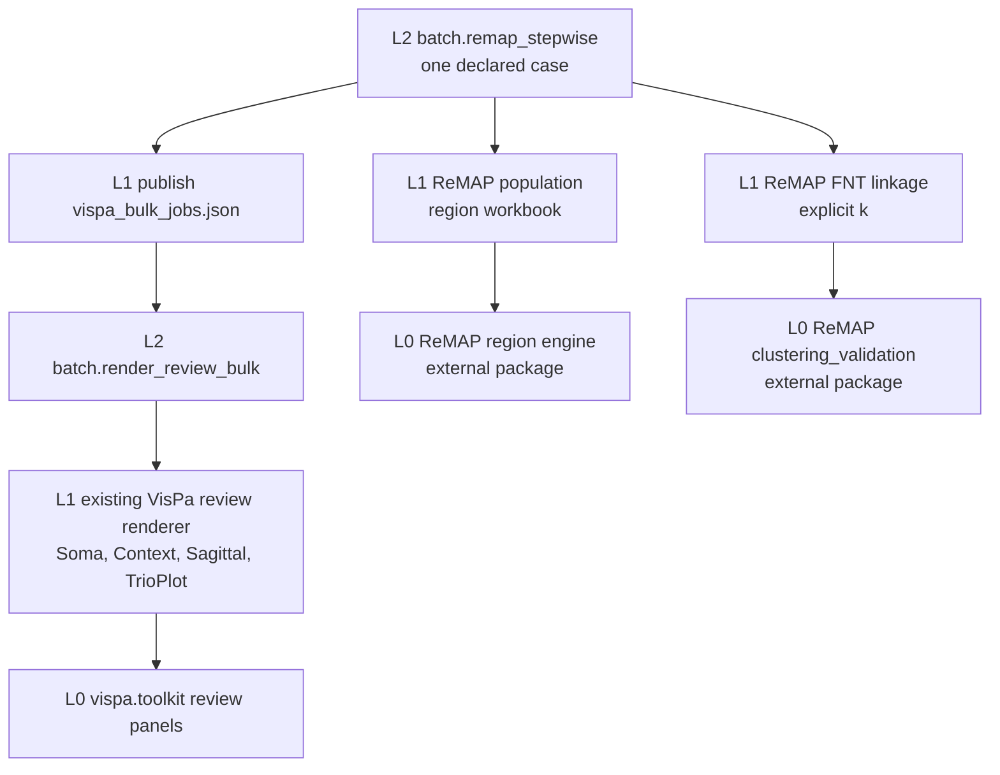

# VisPa remap stepwise batch — hierarchy

**Goal:** Run the current ReMAP region-analysis and saved-score FNT clustering steps, publish the result on an explicit fMOST share slot, and let VisPa render one review figure set per selected neuron.



```text
batch/
├── remap_stepwise.py
├── remap_stepwise.example.json
├── render_review_bulk.py
├── render_brain_views.py
├── MODULE.md
└── README.md
```

## L0 / L1 / L2

| Layer | What it does |
|---|---|
| L0 | ReMAP owns region formulas and FNT distance checks. VisPa toolkit owns review drawing. This folder does not copy either engine. |
| L1 | One population workbook, one FNT linkage file, or one neuron's review panels. |
| L2 | `remap_stepwise` runs region, then FNT, then writes the bulk list. `render_review_bulk` loops that list. A failed item is recorded and the run continues. |

The legacy order was region analysis, an FNT distance file, clustering, then bulk visual plots. This operator keeps that order. Region analysis is ReMAP's population command. Clustering reads a saved joined FNT and distance table; it does not rebuild those files and it does not rewrite SWC coordinates. The cut is the requested `k` with `average`, `complete`, or `single` linkage. `average` and `k=2` are the example settings.

## Share slots

`share_base` defaults to `\\10.102.8.200\microscopy_data\fMOST`. `share_slot` chooses the directory under that root:

| Slot | Directory |
|---|---|
| `remap_outputs` | `remap_outputs/<sample>/<run_id>/` |
| `outputs` | `outputs/<sample>/<run_id>/` |
| `resources` | `resources/remap_stepwise/<sample>/<run_id>/` |

The resources slot is a child folder so the run does not sit beside `config_deb.yaml` and the dependency tree. `--publish share` writes that directory. `--output-root` writes the same layout locally and still records the declared share path. A dry run writes nothing.

## Test

From this checkout:

```powershell
python -m unittest discover -s batch -p "test_remap_stepwise.py" -v
python -m batch.remap_stepwise --case batch/remap_stepwise.example.json --limit 1 --dry-run
```

The example names placeholder inputs, so the second command stops before creating a share directory. Copy it under `work/cases/`, replace every `REPLACE_` path, then use `--limit 1 --dry-run` and a new `--output-root` before `--publish share`.

## Legacy map

| Legacy step | This operator |
|---|---|
| `step1.run_region_analysis.py` | ReMAP `plan_population` / `run_population` |
| `step2_fnt-dist_pipeline.py` | Not rerun. Supply the saved distance file and joined FNT. |
| `fnt_dist_clustering.py` | ReMAP `read_fnt_distances`, `safe_linkage`, and an explicit `k` |
| `bulk_visual_multi_monkey.py` | `render_review_bulk` using the current VisPa review panels |
