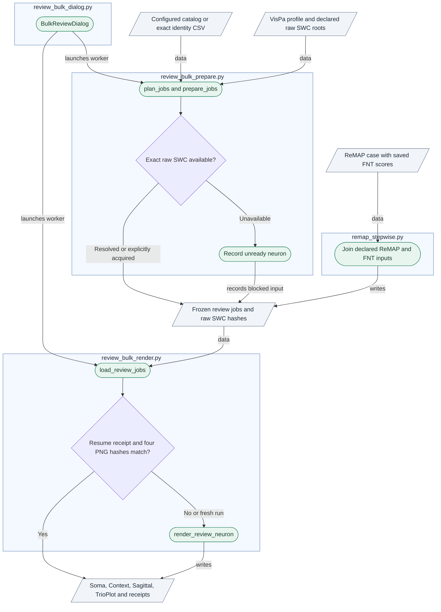

# VisPa batch review

Version 1.21.0. The Bulk review dialog and the packaged commands share one implementation. The ReMAP/FNT bridge and the whole-animal workflow both produce
a frozen review jobs file.

The chart shows calls and data flow. The IONData catalog and declared raw
SWC sources are external inputs.

## GUI

Open **Bulk review…** beside **Render**. The dialog starts with the current
sample and saved profile, the profile's figure root, and a managed raw-cache
location. Choose existing jobs to inspect a completed batch, or select catalog
or CSV identities and declared raw source roots for a new preparation.

1. Use **Preview one** to inspect inputs without preparing jobs.
2. Use **Prepare all** to freeze the animal's identities and cached raw sources.
3. Use **Render one dry run**, then **Render one**, and inspect the figures.
4. Use **Render all** to verify existing results and render the remainder.
   **Resume all** uses the same receipt checks after an interruption.
5. **Open results** opens the sample's figure tree. **Open batch receipt**
   opens the exact run record. A completed batch from another software version
   can be inspected; execution reports a version mismatch before resuming it.

The dialog keeps processing in a background worker and displays the receipt
progress separately from the last action's result. Keep it open while an action
is running. The `batch.prepare_review_bulk` and `batch.render_review_bulk`
compatibility entry points remain available from a checkout.

## Prepare and render one animal

Select the animal by VisPa sample ID. Use the configured catalog with
`--catalog` or provide an exact `sample,neuron_id` CSV with `--identities`.
Repeat `--raw-root` for sources outside the profile. Supply `--source-receipt` to require the expected raw SWC hashes from a prior source receipt.
Preparation uses the raw SWC root as the candidate microscopy center and
records its source and hash. The configured portal soma is a separate
coordinate source. These jobs do not establish coordinate equivalence or
anatomical acceptance.

1. Run `python -m vispa.review_bulk_prepare --config <profile> --sample <sample> --catalog --cache-root <cache> --output-jobs <jobs.json> --limit 1 --dry-run`. Review the resolved IDs and input paths.
2. Repeat without `--dry-run` to prepare the jobs file. Choose a managed cache directory separate from all raw source roots. `--allow-download` explicitly allows fetching missing raw SWCs. Check the jobs file for unready IDs and reasons.
3. Run `python -m vispa.review_bulk_render --jobs <jobs.json> --output-root <local-stage> --limit 1 --dry-run`, then repeat without `--dry-run`. Use a stage separate from the jobs directory. Inspect the four plots and receipt.
4. For an animal run, prepare a new jobs file with `--all` and explicitly render with `--all`. Review the intended root before selecting a server destination. A run-specific subfolder separates the batch figures from existing GUI output.
5. Use `--resume` with the same jobs file and destination after an interruption. Inspect the batch receipt for reused, rendered and unready neurons. Resume reuses a result only if the input identity and four verified PNGs match.

Batch receipts are stored under `<root>/<sample>/bulk_runs/<run>/`. Use a fresh jobs file and output root if a microscopy dataset was replaced in place. Resume checks the frozen SWC, profile, settings and PNG bytes.

The DEB GUI figure root is `X:/fMOST/Vispa_outputs`. Choose a local stage for
the first run. Inspect PNG roles, axes, scale bars, and sagittal extent before
using the configured server root.

## Existing ReMAP and saved FNT jobs

Run `python -m batch.remap_stepwise --case <case.json> --limit 1 --dry-run`,
then use a fresh local `--output-root <path>` for one case. Its jobs file can
be passed directly to `batch.render_review_bulk`. Full render selection
requires explicit `--all` and a jobs file with `allow_all=true`. See the
[example](remap_stepwise.example.json) for case inputs. The ReMAP bridge
requires explicit `--publish share` for its own share publication.

ReMAP endpoint-target categories include all recorded compartments. Retained
regional reconstruction lengths are proxy measures. The FNT path reads the
declared saved scores and records `requested_k` and `realized_k`; `final_k`
remains null. Scientific interpretation and anatomical acceptance require
separate review.
