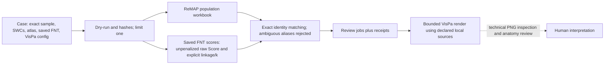

# ReMAP-to-VisPa batch bridge

Candidate 1.12.0.dev2; repository checkout operator, not currently included as an installed wheel command. One JSON case declares exact source and destination paths. [Example](remap_stepwise.example.json) contains placeholders.

Run `python -m batch.remap_stepwise --case <case.json> --limit 1 --dry-run`, then a fresh local `--output-root <path>` for one case. Use `python -m batch.render_review_bulk --jobs <vispa_bulk_jobs.json> --output-root <fresh-path> --limit 1 --dry-run` before rendering. Both commands accept `--version`. Full selection requires explicit `--all` and `allow_all=true`; share publication requires explicit `--publish share`. No existing output root is overwritten. Review config and jobs hashes are checked before use; incomplete panels are reported partial or failed.

Region outputs inherit ReMAP legacy proxy definitions: endpoint-target categories include all recorded compartments, and retained regional reconstruction lengths are not proven axon-only projections. Type, laterality and projection labels are atlas-derived technical outputs, not independent anatomical acceptance. The FNT path reads the supplied complete saved score matrix; it does not regenerate or calibrate distances, and uses all supplied FNT markers for its exploratory clustering, not only render-selected IDs. `requested_k` and `realized_k` are recorded; `final_k` remains null. This bridge does not implement the legacy type-guided penalty or imply biological clusters.

The renderer uses VisPa's configured local raw-SWC adaptor with `allow_download=False`; the config's declared raw root must resolve the same sample/neuron. It never authorizes automatic portal SWC retrieval. When the job derives soma coordinates from a raw SWC, the chosen config's raw SWC must match that recorded hash before and after rendering; summary-derived soma has unknown source equivalence. PNG completion requires four distinct nonempty Soma, Context, Sagittal and TrioPlot files that Pillow identifies, verifies and decodes as PNGs; rendering is technical, not anatomical acceptance.

Validation: initial inherited 9 tests passed, expanded 13 pass; one synthetic neuron ran through actual ReMAP 0.1.0.dev9 planner and population plus a three-marker saved-score FNT fixture. Current VisPa config, adaptor and renderer call signatures were inspected. This bounded test is not a real-microscopy render.
