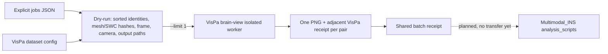

# VisPa brain-view batch operator

Local candidate `1.11.0.dev18`. The entry point is `python -m batch.render_brain_views` from this checkout. Each declared job renders **one OBJ mesh and one processed SWC** with VisPa's existing OpenGL worker. A region mesh must already exist as an OBJ in the same declared coordinate frame and units as the processed SWC. The configured whole-brain mesh remains the ordinary single-view default. No mesh generation, coordinate transform, cohort discovery or data fetch occurs here.



## Bounded local example

Copy [the placeholder settings](local_pilot.example.json) into an untracked file under `work/jobs/`, then replace every placeholder with exact local paths, identities, frame and units. Keep outputs in a sibling directory such as `work/results/`; the operator refuses an output root inside the directory that contains the jobs file. Machine-specific filled jobs and rendered outputs must stay outside version control. The private prior pilot was a wiring and rendering test, not a scientific region-mesh validation.

```powershell
cd D:\VisPa_publish_20261023
python -m batch.render_brain_views --jobs work/jobs/filled-local-jobs.json --output-root work/results/brain-view-batch-new-run --limit 1 --dry-run
python -m batch.render_brain_views --jobs work/jobs/filled-local-jobs.json --output-root work/results/brain-view-batch-new-run --limit 1
```

For a new request, provide `schema=vispa.brain_view_batch.v1`, `vispa_config`, and `jobs` in one JSON file. Each job has explicit `sample_id`, `region_id`, `mesh_path`, `mesh_label`, `neuron_ids`, `coordinate_frame`, `coordinate_units`, optional `portal_region`, and optional `camera_overrides` using VisPa's documented [brain-view setting names and ranges](../README.md#shared-settings-interface).

| Parameter | Default / allowed value | Effect |
|---|---|---|
| `--jobs` | Required JSON path | Declares the exact local mesh and neuron pairs. |
| `--output-root` | Required fresh directory | Contains one PNG/receipt per pair and one batch receipt; existing root refuses. |
| `--dry-run` | Off | Prints resolved hashes, frame/units, camera and paths without writing. |
| `--limit N` | Explicit positive integer | Selects the first N jobs sorted by sample, region and neuron; use `1` for first render. |
| `--all` plus `allow_all` | Both must be explicitly true | Enables all declared jobs; no cohort is inferred. |
| `mesh_label` | `<region_id>`; 1–18 printable ASCII characters | Names the actual OBJ role beside its color patch; set it explicitly when the region ID is longer than 18 characters. |
| `camera_overrides` | `{}`; valid VisPa brain-view settings | Changes the recorded view, such as `camera_distance_scale` for a small region. |

The executed pilot PNG, adjacent snapshot receipt and shared batch receipt remain privately stored under `work/` as review evidence. The command above uses a new output root because existing outputs are never overwritten.

The worker writes one PNG and adjacent JSON receipt with mesh/SWC hashes, source frame, stored units, camera settings, renderer version and PNG hash. The operator writes one `batch_receipt.json` with sorted requests and status. A failed job preserves that receipt with `partial_or_failed`, and the command exits with status 2 after printing the result rather than raising an unhandled traceback. A region OBJ becomes the root mesh for its individual job. Its bounds set the current camera distance; use a declared `camera_distance_scale` override when the region is small and review the resulting PNG for clipping. A batch of jobs is a set of independent views, not a combined multi-neuron scene. The future `Multimodal_INS/analysis_scripts` location is a planned handoff only; this operator remains in VisPa now.

Region analysis through FNT clustering, and the matching VisPa review bulk, are documented in [MODULE.md](MODULE.md).
