# ReMAP

Version: 0.2.2.dev3 (local/unreleased candidate). Portable macaque region and morphology analysis core.

Research resources include the [macaque insula area–function evidence table](src/remap/resources/insula_area_function_evidence_v0.1.0.csv).

ReMAP analyzes explicitly mapped SWC neurons against an atlas and writes local results. Its designated atlas is the fMOST share `resources\dependencies\atlas` tree, using the same paths as VisPa's DEB profile. Explicit atlas paths still replace those defaults. Its population command writes a per-sample workbook with Summary, Soma_Hierarchy, Laterality, terminal/outlier, and L6/L3 projection worksheets. ReMAP does not import the `projectome_analysis` repository.

```mermaid
flowchart TB
    inputs[/"Local SWCs · atlas · hierarchy"/]:::data
    ion[/"IONData getSWC portal"/]:::external
    subgraph loader["region_analysis/neuron_loader.py"]
        load_swc(["ensure_cached_swc()"]):::fn
    end
    ion -. "getSWC bytes when missing or refresh" .-> load_swc

    subgraph operator["population_operator.py"]
        plan(["plan_population()"]):::fn
        run(["run_population()"]):::fn
    end
    subgraph analysis["region_analysis/neuron_table.py"]
        process(["PopulationRegionAnalysis.process()"]):::fn
        save(["PopulationRegionAnalysis.save_all()"]):::fn
        measure(["RegionAnalysisPerNeuron.run()"]):::fn
        parse(["parse_swc()"]):::fn
        classify(["NeuronClassifier.classify_single_neuron()"]):::fn
    end
    subgraph tracer["region_analysis/neuron_swc.py"]
        trace(["NeuronTracer.process() / plot_neuron()"]):::fn
    end
    book[/"Workbook + provenance receipt"/]:::data

    inputs -. "read and hash" .-> plan
    plan -->|"validated plan"| run
    run -->|"calls"| process
    run -->|"calls after processing"| save
    process -->|"loads graph"| trace
    trace -->|"cache hit, or IONData if missing or refresh"| load_swc
    load_swc -. "returns cached SWC path" .-> trace
    process -->|"measures"| measure
    process -->|"classifies"| classify
    save -. "writes" .-> book

    subgraph fnt["morph_clustering/fnt_pipeline.py"]
        produce(["run_pipeline()"]):::fn
        analyze(["run_saved_analysis()"]):::fn
    end
    scores[/"Saved FNT scores + receipt"/]:::data
    hierarchy[/"Candidate hierarchy"/]:::data
    inputs -. "selected local SWCs" .-> produce
    produce -. "writes" .-> scores
    scores -. "optional reuse" .-> analyze
    analyze -. "writes" .-> hierarchy

    registry[/"Shared VisPa DS00 registry"/]:::data
    subgraph selection["ds_normalisation/ds00_selection.py"]
        resolve(["resolve_selection()"]):::fn
    end
    selected[/"Selected source + bundle identity"/]:::data
    registry -. "reads" .-> resolve
    resolve -. "returns" .-> selected

    subgraph prototype["ds_normalisation/coordinates.py · local only"]
        convert(["CoordinateRoute.convert()<br/>Not integrated with population"]):::candidate
    end

    prog_operator[/"remap progress or VisPa preview"/]:::data
    prog_inputs[/"Saved Projectome CSV and optional ARM receipt"/]:::data
    prog_outputs[/"Count plan or PNG with receipt"/]:::data
    subgraph prog["cohort_progress.py"]
        prog_build(["build_report()"]):::fn
        prog_export(["export_report()"]):::fn
    end
    prog_operator -->|"calls"| prog_build
    prog_inputs -. "read and reconcile" .-> prog_build
    prog_build -->|"validated counts for export"| prog_export
    prog_build -. "dry-run data" .-> prog_outputs
    prog_export -. "writes" .-> prog_outputs

    classDef fn fill:#E8F5EE,stroke:#23845B,color:#16392C,stroke-width:1.5px
    classDef data fill:#F1F5F9,stroke:#64748B,color:#1E293B
    classDef external fill:#FFFFFF,stroke:#64748B,color:#334155,stroke-dasharray:4 3
    classDef candidate fill:#FFF5DD,stroke:#B7791F,color:#674719,stroke-width:1.5px,stroke-dasharray:5 3
    style operator fill:#F4F8FF,stroke:#6186B5,color:#243C5A
    style analysis fill:#F4F8FF,stroke:#6186B5,color:#243C5A
    style tracer fill:#F4F8FF,stroke:#6186B5,color:#243C5A
    style classifier fill:#F4F8FF,stroke:#6186B5,color:#243C5A
    style fnt fill:#F4F8FF,stroke:#6186B5,color:#243C5A
    style selection fill:#F4F8FF,stroke:#6186B5,color:#243C5A
    style prototype fill:#FFFBF2,stroke:#B7791F,color:#674719,stroke-dasharray:5 3
    style processor fill:#F4F8FF,stroke:#6186B5,color:#243C5A
```



Blue containers identify Python files; green stadiums identify functions/methods; gray parallelograms identify data. Solid arrows show calls or the labelled execution handoff; dotted arrows show labelled data access/production. `processed_source.py` is ReMAP's own opt-in processor for one exact missing processed SWC. Amber dashed borders mark the uncommitted coordinate candidate without changing its function shape. This is a compact mixed call/data overview; parser internals and hierarchy helpers are omitted. ReMAP does not write legacy Projectome progress files.

`remap ds00-selection --registry <registry.json> --sample-id <exact ID>` reads one active native DS00 and normalization selection, including the saved normalization bundle hash. It reports `region_ready=false`. Supplying `--swc-frame` fails because the processed SWC to sharedPitch10 binding remains unverified. This command does not change Step1 atlas inputs or run region analysis.

The local `remap.ds_normalisation.coordinates` API carries `Points(xyz, frame, unit)` and rejects incompatible declarations. `CoordinateRoute.convert` connects declared raw, native DS00, prepared-pitch and NMT image grids in both directions. A `SavedBridge` requires explicit forward **and reverse** point chains: nonlinear inverse fields are supplied, never inferred by negating a warp. NMT-registered DS00 and the NMT template share physical space only under the evidenced registration; each image retains its own voxel affine. This API converts points; it does not resample intensity or label images.

VisPa already supplies the native microscopy arithmetic in `vispa.image_geometry.native_to_index` and `native_affine`. Use those helpers to supply the native 5 um image calibration; this avoids importing VisPa as a mandatory ReMAP dependency. Its current widefield convention is nominal XYZ spacing **5/5/3 um**, ZYX array storage, and section index times Z spacing. Preserve crop origin and filename-index conventions. `raw_to_5um_grid` and its inverse require a supplied calibration rather than guessing isotropic spacing. DS00 conversion requires actual sample shape/anisotropic spacing, explicit raw A/B candidate and generic/special-747 permutation. Raw-axis origin/calibration remains provisional.

IONData already supplies raw and processed SWC representations (legacy `getRawNeuronTreeByID` and `getNeuronTreeByID` respectively); reuse those inputs rather than regenerate the supplied processed file. Newly mapped raw SWCs under the selected DS00 normalization are separately named derivatives.

The dev14 `population` operator keeps the existing exact local `swc_source_dir` and `neuron_ids` contract. To opt into missing processed SWC retrieval, set `processed_source` to `portal`, `http_host` to the IONData origin, `workspace_root` to this ReMAP checkout, and `processed_cache_root` under its `work/`; keep `output_base` under the same `work/`. `--dry-run` resolves each exact ID to a local file or a `getSWC` URL without fetching or writing. Execution calls `load_processed_swc` only for a missing local file, writes the response bytes under the declared cache, and records source hashes in the population receipt. The default `processed_source` value `local` stays offline and rejects portal settings. This uses the historical supplied processed representation for the existing `/250` region operator. It does not establish a processed-to-NMT transform or scientific acceptance.

Processed SWCs are a separate stored-coordinate representation: VisPa currently samples the declared atlas using `round(xyz/250)`. Historical `/250` and its inverse preserve that encoding and unknown physical source units. Connecting it to NMT requires an explicit matching atlas-grid binding. VisPa's existing `pair_processed` validates node IDs/types/parents and supplies corresponding coordinates for the same graph; node matching alone does not define a continuous inverse warp for arbitrary points. No filename establishes the processed frame.

`map_swc_rows` changes XYZ in memory while preserving IDs, types, parents and source radii; the caller must label the unchanged radius units. These coordinate exports do not establish valid deformed morphometry. Validation: six coordinate tests pass. The bounded [945 round-trip receipt](work/coordinate_roundtrip_945_20261103.json) and [reproducer](work/coordinate_roundtrip_945_20261103.py) record one saved ANTs raw-to-NMT-and-back test (0.176014 um return error), with forward coordinates matching the earlier saved control. This is numerical consistency, not anatomical acceptance. Source hashes, sample-specific calibration and the selected registration bundle belong in the caller's receipt.

Once a sample-specific `CoordinateRoute` and ANTs point executor are supplied, the same interface selects either direction:

```python
raw = Points(raw_xyz_um, "raw_swc_xyz", "um")
nmt_voxels = route.convert(raw, route.nmt_frame, apply=ants_points)
raw_again = route.convert(nmt_voxels, "raw_swc_xyz", apply=ants_points)
```

The optional `grid_5um_frame`/`raw_um_to_5um_voxel` descriptor connects VisPa acquisition geometry; `processed_swc_frame`/`processed_to_nmt_voxel` connects only a declared processed encoding. Missing bindings raise an error. These descriptors enable the common API; they do not prove a real dataset is correctly calibrated. In-memory SWC mapping leaves source files untouched.


The separate raw-SWC route has been executed conditionally for 945/252527: candidate-A anisotropic raw-to-corrected-native coordinates, native-to-pitch affine, then the saved DS00-to-NMT point chain. Existing VisPa receipts cover three A/B full-graph controls and 99 raw somas. Raw-axis origin/calibration remains provisional; this route is not implemented by ReMAP's historical `/250` population operator. `region_ready=false` describes the current ReMAP integration boundary, not absence of a working candidate coordinate transform. See `D:/VisPa_publish_20261023/work/ds00_portal_region_comparison_20261103/known_region_nmt_pilot.json` and `945_all_available_raw_soma_transitions_receipt.json` in the same folder.

## Interpreting legacy region-analysis outputs

The region-analysis path preserves historical computational behavior. Matching a legacy workbook demonstrates technical parity for the tested inputs; it does not establish anatomical accuracy, biological terminals, connectivity, or the validity of a cell type. Input space, atlas mapping, reconstruction completeness and registration require separate review.

- **Leaves and types:** the endpoint/target-region list comes from graph leaves of all SWC compartments. A leaf is a computational endpoint, not a verified axon terminal, bouton or synapse. The legacy PT/CT/ITs/ITc/ITi labels are priority-based proxies derived from regional leaf evidence; they are not the Gou manual-arbor classification or independently validated biological identities. Missing type-2 nodes or axon evidence are not evidence of biological absence. Treat unsupported classifications as unassessed for interpretation.
- **Regional lengths:** for each parent-to-child edge, the current implementation measures distance in mapped atlas-index coordinates, rounds the edge length to three decimals, and assigns the whole edge to the atlas voxel obtained by rounding its proximal node coordinates. It then retains regional length only where that region contains at least one graph leaf. This is a region-wide all-compartment leaf gate, not axon-only length or a boundary-split physical measurement.
- **Displayed strength:** population strength is `round(log10(retained regional length + 1), 4)` after the applicable regional aggregation. It depends on the coordinate units supplied to the analysis; it is a display transform, not a unit-independent connection strength.

A future presentation or evidence-status layer could expose compartment coverage, unknown labels and review status without changing legacy numeric outputs. That layer is proposed, not implemented. Do not silently replace missing or unassessed evidence with a biological negative, or infer scientific acceptance from a technically successful run.

## Install and operate

Use Python 3.10 or newer. To run the current ReMAP source from PowerShell, start in `packages/remap` and use the active VisPa environment.

```powershell
$env:PYTHONPATH = (Resolve-Path ./src).Path
python -m remap --version
python -m remap --help
```

For an installed ReMAP CLI, use the package folder.

```text
python -m pip install .
remap --version
remap --help
remap population --help
remap fnt-pipeline --help
remap fnt-analyze --help
```

Run `remap population --config <path> --dry-run` to inspect resolved inputs, settings, and outputs. Use `--neuron-id <exact SWC basename>` for a bounded single-neuron run, then omit that flag for the declared cohort. The population JSON supplies sample identity, SWCs, template, hierarchy tables, coordinate mapping, and the output destination. Atlas volume, key, and hemisphere mask may be omitted; they then resolve to the designated YAML profile below. A path written in that JSON replaces the matching YAML default, and `remap one --atlas` or `--atlas-key` does the same for a single neuron. A dry run hashes the resolved files, so the share or the override paths must be reachable. `remap one`, `remap table`, and `remap fnt` retain their bounded operators.

## Progress Manager

ReMAP reads a saved Projectome Progress Manager CSV and an optional matching
ReMAP regional measurement receipt. It validates sample, parcel and hemisphere
counts before charting them. The receipt supplies recorded projection types.
The legacy Projectome operator produces and refreshes the upstream snapshot.

```powershell
remap progress --snapshot data_progress_table.csv --cohort receipt.json --dry-run
remap progress --snapshot data_progress_table.csv --cohort receipt.json --output insula_cohort_progress.png
```

Use `--sample 251637` for one exact sample or `--dpi 200` for the output
resolution. The `plots` extra provides PNG rendering. The optional cohort join
reconciles the saved aggregate counts. The [separate 1,732-identity recount and
cohort diagram](../../../../work/remap_clustering_all_monkeys_20261117/README.md#dated-cohort-clarification)
document the membership audit for the current 309.

## Designated share atlas

ReMAP is designated to use the same read-only fMOST atlas resources as VisPa. The checked-in profile is `src/remap/configs/config_deb.yaml`, the same kind of YAML file VisPa ships. It copies `sources.atlas` from VisPa `src/vispa/configs/config_deb.yaml` at commit `aed0077e1b9987a4a3aeac5507fc6f1a5688ff3c` (`ded_vispa_config` 1.0.12, updated 2026-11-09). Those paths sit under `resources\dependencies\atlas`. The package records the UNC paths and does not bundle NIfTI or key bytes.

```text
atlas            \\10.102.8.200\microscopy_data\fMOST\resources\dependencies\atlas\NMT_v2.1_sym\ARM_in_NMT_v2.1_sym.nii.gz
atlas_key        \\10.102.8.200\microscopy_data\fMOST\resources\dependencies\atlas\NMT_v2.1_sym\ARM_key_all.txt
hemisphere_mask  \\10.102.8.200\microscopy_data\fMOST\resources\dependencies\atlas\NMT_v2.1_sym\NMT_v2.1_sym_LR_plane.nii.gz
version          NMT_v2.1_sym
coordinate_scale 250 µm
```

VisPa names those three files as `sources.atlas.root`, `sources.atlas.key`, and `sources.atlas.hemisphere_mask`. ReMAP's YAML uses the same paths, with `coordinate_scale: 250` for VisPa's `coordinate_scale_um`. `remap population` uses them when its JSON omits `atlas`, `atlas_key`, or `hemisphere_mask`. `remap one` uses the volume and key when `--atlas` and `--atlas-key` are omitted. `--declared-space` and `--coordinate-scale` stay explicit; the designated scale is 250. A path in the population JSON or on the `remap one` command line wins over the YAML default.

```text
remap one --swc 004.swc --sample-id 251637 --neuron-id 004.swc --declared-space "NMT_v2.1_sym atlas voxel index (caller declaration)" --coordinate-scale 250 --output 004.json --dry-run
remap one --swc 004.swc --atlas /your/atlas.nii.gz --atlas-key /your/ARM_key_all.txt --sample-id 251637 --neuron-id 004.swc --declared-space "NMT_v2.1_sym atlas voxel index (caller declaration)" --coordinate-scale 250 --output 004.json --dry-run
```

VisPa's atlas block does not name a template or CHARM/SARM hierarchy CSV, so the population config still supplies `template`, `cortex_hierarchy_csv`, and `subcortical_hierarchy_csv`. ReMAP does not invent another share folder for them.

```json
{
  "sample_id": "251637",
  "neuron_ids": ["004.swc"],
  "swc_source_dir": "/your/swc",
  "template": "/your/template.nii.gz",
  "cortex_hierarchy_csv": "/your/charm.csv",
  "subcortical_hierarchy_csv": "/your/sarm.csv",
  "output_base": "/your/remap-out",
  "declared_space": "NMT_v2.1_sym atlas voxel index (caller declaration)",
  "coordinate_scale": 250,
  "coordinate_offset": [0, 0, 0]
}
```

`PopulationRegionAnalysis._detect_and_load_hierarchy` is a fallback inside `add_hierarchy_columns`. It is not the live `remap population` path. That fallback checks the designated share key first, then a neighboring `atlas` folder. `load_dual_hierarchy_from_paths` stays unused by the population command and loads hierarchy tables only from a directory the caller passes. The live atlas source is this share profile. `D:\projectome_analysis` and `VisPa_publish_...` folders are not atlas defaults.

## Bounded FNT producer

`remap fnt-pipeline` produces FNT scores from explicit, hash-bound local SWCs with four local Windows `.exe` FNT binaries (`fnt-from-swc.exe`, `fnt-decimate.exe`, `fnt-join.exe`, `fnt-dist.exe`). The region-analysis core remains portable. The default preprocessing applies the established legacy nodewise fold `x > 32000 -> 64000 - x`; decimation uses distance 5000 and area 5000. The default preserves the local legacy formula, including its midline-crossing geometry. It is a technical compatibility baseline, not a validated anatomical transform.

Set `workspace_root` and `output_root` to an operator-owned workspace outside this repository. Each run refuses an existing output directory. Use a first dry run, then a bounded production run:

```text
remap fnt-pipeline --config fnt.json --max-cases 2 --dry-run
remap fnt-pipeline --config fnt.json --max-cases 2
```

Minimal `fnt.json` schema (replace example paths and hashes with real local values):

```json
{
  "workspace_root": "/your/workspace",
  "output_root": "/your/workspace/work/fnt-run-001",
  "binary_dir": "/your/fnt-binaries",
  "cases": [
    {"sample_id": "sample1", "neuron_id": "001.swc", "swc_path": "/your/sources/001.swc", "swc_sha256": "<64 hex SHA-256>"},
    {"sample_id": "sample1", "neuron_id": "002.swc", "swc_path": "/your/sources/002.swc", "swc_sha256": "<64 hex SHA-256>"}
  ]
}
```

For CSV/XLSX selection, use `cohort_table` with exact `SampleID`, `NeuronID`, `SWCPath`, `SWCSHA256` columns and a nonempty `selected_uids` list instead of `cases`. Production accepts 1–32 cases. `timeout_seconds` accepts 10–3600 seconds. Input and binary hashes, exact marker binding, complete distance-pair coverage, resolved settings, and source postchecks are recorded in the receipt. Unknown settings fail before outputs are created; malformed SWCs fail before processed-SWC writes. The producer does not choose a final cluster count. `decimation.enabled` must be a JSON boolean; explicit `false` (or `--decimation off`) retains converted geometry without running the decimator. This is an optional compatibility-sensitive geometry control, not a scientifically accepted default. The default remains enabled at 5000/5000.

## Legacy analysis notes and evidence

The historical region-analysis terminology guide preserves metric definitions and their interpretation limits; it links back to the original Projectome evidence.

The standalone ReMAP README, changelog and insula note were imported with the
package from commit 619fdd0e3e1bdfa04dcd5a3464ba30d93dcf70a7. The living
cross-project record is [the VisPa and ReMAP project note](../../docs/project_note.md).
The earlier 251637 clustering review
records the historical methods, figures, limitations and source identities.

The historical 251637 FNT data contain 212 markers and 22,578 triangular
pairs. The joined FNT marker order defines identity. Score units, acquisition
dates and score-producer lineage remain unknown. The current 574-row neuron
table includes all 212 markers; the remaining 362 have no score in this
historical matrix. Candidate labels require scientific review. Earlier review
links under D:/ReMAP/work may refer to outputs no longer present there.

Recent source-based comparisons and their metadata are under
D:/VisPa_publish_20261023/work/remap_clustering_251637_20261117/.
They compare raw-average, raw-complete, log1p-average and
Spearman-profile-average settings with 20 subsamples. They remain exploratory.
Additional Projectome history is available in the ARM projection clustering review and region-analysis code audit. They retain historical findings and link to original evidence; later fixes and acceptance are recorded in the project journal.

## Evolve a neuron table with candidate labels

Use the source-based command with an explicit sample and one or more named
assignment CSVs. Each CSV must contain unique FNT_NeuronID stems and positive
integer k_ columns. All CSVs must cover the same neurons, and every identity
must appear in Summary. Output retains the source sheets and adds FNT candidates
and FNT provenance sheets. Unscored rows retain blank labels. The provenance
sheet records workbook and assignment CSV hashes. Keep upstream score and
method receipts alongside the output.

    python -m remap clustered-table --source input.xlsx --output clustered.xlsx --sample 251637 --assignment raw-average candidate_cluster_assignments.csv --dry-run

Remove --dry-run to create a new output. Existing outputs are refused.
Candidate labels are exploratory and do not select a final cluster count.
For a validated raw score matrix and dendrogram, run python -m remap.morph_clustering.score_plot --distance scores.txt --joined-fnt joined.fnt --output plot.png --linkage complete --dry-run. Remove --dry-run to render a new PNG with input hashes and settings embedded in its metadata. Linkage, title and DPI are shown by --help.

For a reusable parameter comparison, run python -m remap.morph_clustering.compare --distance scores.txt --joined-fnt joined.fnt --output NEW_DIRECTORY --representation raw --linkage complete --dry-run. Remove --dry-run to calculate candidate assignments, stability diagnostics and metadata. The command accepts raw, log1p or spearman_profile representations, explicit k range, subsample count, fraction and seed. It leaves final_k unset.

A comparison run writes metadata.json only after its assignment, diagnostic and stability CSVs have been saved and hashed. Inspect those hashes before consuming an output. A directory without metadata.json is incomplete; choose a fresh output path when retrying.

The comparison command accepts --score-mode ratio for the explicit sensitivity Score / (Match + NoMatch). It requires validated finite weights and positive denominators. Raw remains the default; the historical meaning and producer of these fields remain unverified.

## Saved-score analysis and review

`remap fnt-analyze --producer-receipt <receipt.json> --config <analysis.json> --max-cases <3..32> --dry-run` checks the saved producer hashes and exact identity order. Run without `--dry-run` to write one candidate hierarchy under a new `output_root` without recomputing FNT scores. The analysis config supplies `workspace_root`, a new `output_root` under its `work/` folder, and `clustering` settings. The producer receipt supplies case identities and identity order; saved-score analysis validates the receipt, joined FNT and score hashes without requiring the original SWCs or FNT binaries. Offline receipt cases are projected onto the strict required identity/source schema; unknown analysis settings still fail. Boolean controls require JSON booleans. Set `clustering.enabled=true`; `candidate_k` is an explicit list of exploratory cuts. The receipt keeps `final_k=null` and reports realized cluster counts alongside requested cuts. Weighted pair parsing allows negative roundoff only down to -1e-8 and records observed minima; larger negative weights, nonfinite values, and invalid totals fail.

The available analysis settings include `score_mode=raw|ratio`, `representation=raw|log1p|spearman_profile`, optional broad-type penalties, and `linkage=average|complete|single|ward_d2|ward_presquared`. The optional settings correspond to distinct exploratory methods: Gou's `2-analysis.jl` uses a fixed 9000 different-type penalty and `ward_presquared`; a separate `gapr/src/3-macaca.jl` branch uses a half-maximum penalty and Ward; a local R sensitivity uses Spearman profiles, a 1.5-times-maximum penalty, and Ward.D2. Do not combine these into an asserted exact paper reproduction. The author's adaptive `gapr` decimator, original distance helper, and branch ordering are outside this package's validated producer.

The source project tested four bilateral cases and five seeded cases across four animals against historical marker-bound scores: 10/10 and 15/15 pair entries matched exactly. A fresh same-input, strict-zero comparison of 18 selected neuron instances across nine paired ReMAP/original Step1 runs matched all 14 workbook sheets in each run. These are bounded technical checks. A three-case FNT visual audit retained 81.5–90.2% of sampled path length after decimation and showed branch straightening; those images do not establish anatomical acceptance. Broader native-image visual QC, full-cohort parity, coordinate lineage, biological subtype interpretation, and any final K remain pending. Scientific candidate outputs require separate review before legacy PA registration or interpretation.

Project-specific batch orchestration and exploratory morphology or navis pilots remain local and are not part of this portable release.

### Atlas-insula hierarchy display

Use the existing `python -m remap.morph_clustering.review_plot` command with the parent FNT receipt, projection tables and candidate profile. Add `--alternative-style neuron_projection --atlas-insula-receipt <ARM-L6-measurement-receipt>` to save the atlas-only panel. A dry run validates the full atlas membership and the saved soma region, hemisphere, type and animal ID. The command records the framed annotation key in the display receipt.

The display removes other leaves from the parent hierarchy and retains the original merge heights and candidate labels. The target order and bilateral length scale follow the parent profile. Counts in the framed key describe the displayed cohort. This view supports direct comparison with the full-cohort plot.
